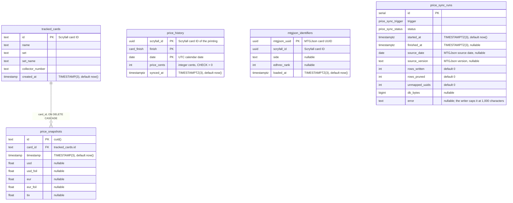

# Mox Market — Entity relationship diagram

> Living ERD. Update it in the same branch as any migration: `tests/contract/erd.test.ts` fails until every model, column, relation and enum in `prisma/schema.prisma` appears here. Seeded by S1.1 (`0000_baseline`); extended by S0.1 (`0001_price_history`); S5.1 (`0002_recommendation_log`) extends it next.

Entity names are the database table names (`@@map`) and attribute names are the database column names (`@map`), not the Prisma field names. An enum-typed attribute's type is the enum's database name (`@@map`); Mermaid's `erDiagram` has no enum construct, so the enums and their values are listed under [Enums](#enums).

| Table | Owner | Notes |
|-------|-------|-------|
| `tracked_cards` | V1, retained until the contract migration | Watchlisted cards. Dropped by F0 W5's contract migration, after S0.3. |
| `price_snapshots` | V1, retained until the contract migration | Wide rows from the V1 cron, watchlisted cards only. Dropped by the same contract migration. |
| `price_history` | F0 (S0.1, `0001_price_history`) | One price per `(scryfall_id, finish, date)`: the composite primary key is both the read path and the ingest's upsert target. No foreign key and no other index. |
| `mtgjson_identifiers` | F0 (S0.1, `0001_price_history`) | MTGJson UUID to Scryfall card ID, loaded whole by the sync. No foreign key. |
| `price_sync_runs` | F0 (S0.1, `0001_price_history`) | One row per ingest or sync run; freshness reads the newest `ok` `cron` or `bulk` run. |

Indexes and settings:

- `price_snapshots_card_id_timestamp_idx` on `price_snapshots (card_id, timestamp)` (V1).
- `price_history_pkey` on `price_history (scryfall_id, finish, date)`, the table's only index.
- `price_sync_runs_status_finished_at_idx` on `price_sync_runs (status, finished_at)`, for the freshness read.
- Hand-added in `0001_price_history` (Prisma's schema cannot express them): `price_history_price_cents_check` `CHECK (price_cents > 0)`, and `price_history`'s `autovacuum_vacuum_scale_factor = 0.02` and `autovacuum_vacuum_insert_scale_factor = 0.02` (C2-A.8).

## Enums

| Enum | Values (in order) |
|------|-------------------|
| `card_finish` | `normal`, `foil`, `etched` |
| `price_sync_trigger` | `cron`, `bulk`, `identifiers` |
| `price_sync_status` | `running`, `ok`, `source_stale`, `budget_stop`, `error` |
