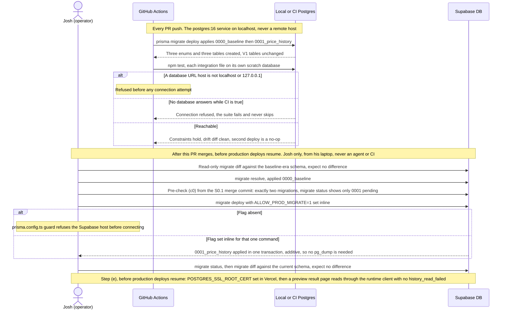
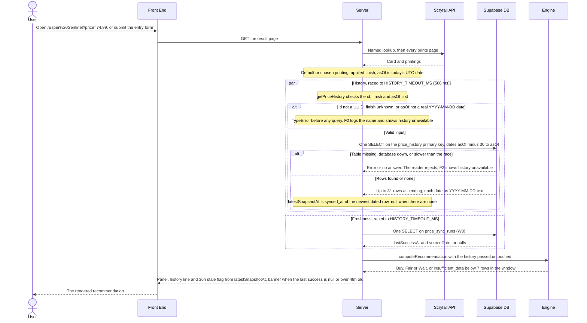
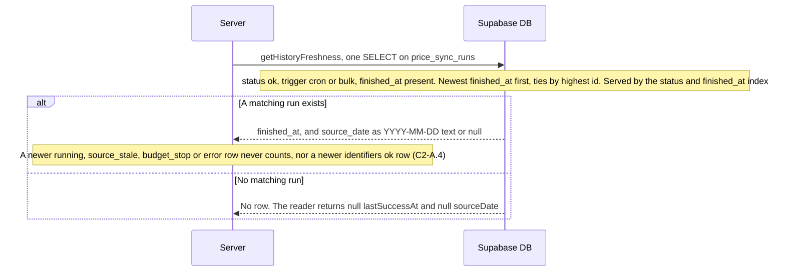

# S0.1 — Price history schema, migration & reader

> Story: [Notion S0.1](https://app.notion.com/p/3f1a7227e26f81f4a017d52079407131) · Design: [F0 Price History Pipeline](https://app.notion.com/p/3f1a7227e26f81dfb405f63e9d3adc71) (Approved, Josh 2026-10-10 22:36; §Functionality storage, money and history reader, W3, W5 expand step, §Fields, storage budget) · Contract: S2.1's `PriceHistoryReader` in `src/lib/evaluation/history-reader.ts` and [F1 Price Recommendation Engine](https://app.notion.com/p/394a7227e26f813e8e97f395b70c0eb3)'s `PriceSnapshot` (Approved, Josh 2026-10-08) · Consumer: [F2 Live Evaluation Integration](https://app.notion.com/p/394a7227e26f81b7b3ccf5f51168130c) (Approved, Josh 2026-10-08; `loadMarketSnapshot` and its `HISTORY_TIMEOUT_MS` race, unchanged) · Standards: [Development Standards](https://app.notion.com/p/394a7227e26f810e956ef0c76c907c95) (Draft; one history one tool, schema stories serialized, Testing, DoD) · PR: #15 · Critique: docs/critiques/C1-2026-10-04-phase1-designs.md#C1.01, C1.04, C1.05, C1.09, C1.17, C1.22, C1.31, C1.32, C1.63 · docs/critiques/C2-2026-10-05-new-pages.md#C2-A.4, C2-A.8, C2-A.10, C2-A.11 · docs/critiques/C3-2026-10-08-s1.1-plan.md#C3.3, C3.8

## Objective
The expand step of F0 (W5) plus the history reader (W3). Add the `card_finish`, `price_sync_trigger` and `price_sync_status` enums and the `price_history`, `mtgjson_identifiers` and `price_sync_runs` tables to `prisma/schema.prisma` exactly as F0 §Fields specifies, and commit `prisma/migrations/0001_price_history/migration.sql`: Prisma-generated, plus the hand-added `CHECK (price_cents > 0)` and autovacuum settings, additive only, with V1's `tracked_cards` and `price_snapshots` untouched. Implement `src/lib/price-history.ts` against S2.1's `PriceHistoryReader` (`getPriceHistory(scryfallId, finish, asOf)`, `getHistoryFreshness()`) and repoint `defaultHistoryReader` at it, so `/[card]` reads real history. Update `docs/architecture/erd.md` (AC-9).

**Pivots (already recorded in Notion on S0.1, S0.3 and F0; not re-recorded).** (1) S2.1 shipped first and owns the reader contract: this story implements it and repoints the default; S2.1's loader and timeout race do not change. (2) Josh applies `0001_price_history` to production **after** this PR merges, after his S1.1 baseline diff and resolve, and before production deploys resume (S0.1d14). Until he does, preview deployments, which share the production Supabase store, hit a missing table: the real reader throws and F2 renders "Price history temporarily unavailable" with the stale-data banner. Locally and in CI the tables exist but stay empty until S0.2's ingest, so cards remain `insufficient_data` there.

Out of scope: every writer (S0.2's ingest script, S0.3's sync route and cron), the contract migration that drops V1's tables (F0 W5 step 3), F5 logging.

## Endpoints                                    <!-- only if API surface changes -->
None. No route is added or changed. `/[card]` keeps its contract and now reads `price_history` and `price_sync_runs` through the repointed default reader: SELECT only, no writes in a render (C1.28). `/api/prices/snapshot` is never called.

## Data Model                                   <!-- only if models change; update docs/architecture/erd.md in the same branch -->
Schema additions (F0 §Fields; S0.1d2). Validated with `prisma validate` on a scratch copy, 2026-10-10:

```prisma
enum CardFinish {
  normal
  foil
  etched

  @@map("card_finish")
}

enum PriceSyncTrigger {
  cron
  bulk
  identifiers

  @@map("price_sync_trigger")
}

enum PriceSyncStatus {
  running
  ok
  source_stale
  budget_stop
  error

  @@map("price_sync_status")
}

model PriceHistory {
  scryfallId String     @map("scryfall_id") @db.Uuid
  finish     CardFinish
  date       DateTime   @db.Date
  priceCents Int        @map("price_cents")
  syncedAt   DateTime   @default(now()) @map("synced_at") @db.Timestamptz(3)

  @@id([scryfallId, finish, date])
  @@map("price_history")
}

model MtgjsonIdentifier {
  mtgjsonUuid String   @id @map("mtgjson_uuid") @db.Uuid
  scryfallId  String   @map("scryfall_id") @db.Uuid
  side        String?
  edhrecRank  Int?     @map("edhrec_rank")
  loadedAt    DateTime @default(now()) @map("loaded_at") @db.Timestamptz(3)

  @@map("mtgjson_identifiers")
}

model PriceSyncRun {
  id            Int              @id @default(autoincrement())
  trigger       PriceSyncTrigger
  status        PriceSyncStatus
  startedAt     DateTime         @default(now()) @map("started_at") @db.Timestamptz(3)
  finishedAt    DateTime?        @map("finished_at") @db.Timestamptz(3)
  sourceDate    DateTime?        @map("source_date") @db.Date
  sourceVersion String?          @map("source_version")
  rowsWritten   Int              @default(0) @map("rows_written")
  rowsPruned    Int              @default(0) @map("rows_pruned")
  unmappedUuids Int              @default(0) @map("unmapped_uuids")
  dbBytes       BigInt?          @map("db_bytes")
  error         String?

  @@index([status, finishedAt])
  @@map("price_sync_runs")
}
```

`0001_price_history/migration.sql` is the generated diff from the baseline-era schema (dry run 2026-10-10: `CREATE TYPE` × 3 for the enums, `CREATE TABLE` × 3 with `price_history_pkey PRIMARY KEY ("scryfall_id","finish","date")`, `mtgjson_identifiers_pkey`, `price_sync_runs_pkey` on a `SERIAL` id, and `CREATE INDEX "price_sync_runs_status_finished_at_idx" ON "price_sync_runs"("status", "finished_at")`), followed by the hand-added block (S0.1d3):

```sql
-- Hand-added (F0 §Fields, C2-A.8): Prisma's schema cannot express these two.
ALTER TABLE "price_history" ADD CONSTRAINT "price_history_price_cents_check" CHECK ("price_cents" > 0);
ALTER TABLE "price_history" SET (autovacuum_vacuum_scale_factor = 0.02, autovacuum_vacuum_insert_scale_factor = 0.02);
```

Fix step (S0.1d24, S0.1d25): the file is wrapped in `BEGIN;` … `COMMIT;`, and a second hand-added block enables row level security on the three F0 tables. Nothing in `0001` names `tracked_cards` or `price_snapshots`. No foreign key (most printings are not in V1's `tracked_cards`). `docs/architecture/erd.md` gains the three entities and an enum table, and labels both V1 tables "V1, retained until the contract migration" (S0.1d19).

## Sequence Diagrams                            <!-- main workflows only; Mermaid -->

### W1: Schema rollout, local and CI now, production by Josh after the merge (AC-1, AC-2, AC-10)


### W2: The result page reads history through the real reader (AC-3 to AC-6, AC-8)


### W3: Freshness picks the newest successful price run (AC-7, AC-8)


## Test Manifest
Shared fixtures: `ID_A` = mh2 #12 `f3537373-ef54-4578-9d05-6216420ee349`, `ID_B` = sld #2123 `f8b6c532-b837-42b6-9ed2-0231d0779626` (S2.3's real ids), `AS_OF` = `2026-10-10`. Integration files create one scratch database each on the server named by `POSTGRES_URL_NON_POOLING` (localhost only), run `prisma migrate deploy` into it, seed with parameterized `pg` inserts (never through the reader), and drop it `WITH (FORCE)` afterwards (S0.1d10). Unit tests use a fake client whose `$queryRaw` is a spy.

| ID | Test | Type | Covers | Notes |
|----|------|------|--------|-------|
| T1 | `prisma/price-history-migration.test.ts`, the SQL as text: every statement (comments stripped) is one of an allowlist: `CREATE TYPE` for exactly the three enums with their values in F0's order, `CREATE TABLE` for exactly `price_history`, `mtgjson_identifiers`, `price_sync_runs`, `CREATE INDEX "price_sync_runs_status_finished_at_idx"`, and the two hand-added `ALTER TABLE "price_history"` lines verbatim; the raw text (comments included) contains no `DROP`, no `RENAME`, no `ALTER COLUMN … TYPE` and no `ALTER TABLE … DROP`, matched case-insensitively across line breaks; it never names `tracked_cards` or `price_snapshots`; it starts with `-- CreateEnum` and carries no CLI banner; migration directories are exactly `0000_baseline`, `0001_price_history` in that order, one per prefix. Negative cases: the checker flags `DROP TABLE x`, `drop index y`, `ALTER TABLE "t" RENAME COLUMN a TO b`, `ALTER TABLE t ALTER COLUMN c TYPE bigint`, the same split over two lines, `ALTER TABLE t DROP CONSTRAINT k`, and an `UPDATE` or `INSERT` outside the allowlist | unit | AC-1 | S0.1d3 |
| T2 | `prisma/price-history-migration.int.test.ts`, deploy on an empty database: `migrate deploy` exits 0 and its output names `0000_baseline` before `0001_price_history`; `_prisma_migrations` holds exactly those two, finished and not rolled back, in `started_at` order; the three tables exist in `public`; `pg_enum` labels equal F0's values in order for all three enums; `information_schema.columns` for each new table equals §Fields (name, type including `uuid`, `date`, `timestamp with time zone`, `bigint`, user-defined enum type names, nullability, defaults `now()`/`CURRENT_TIMESTAMP`, `0`, the serial sequence); `price_history_pkey` covers `(scryfall_id, finish, date)` in that order and `price_history` has no other index; `price_sync_runs_status_finished_at_idx` covers `(status, finished_at)`; no new table has a foreign key; `pg_class.reloptions` for `price_history` holds both `0.02` settings; the CHECK exists with definition `CHECK ((price_cents > 0))`. V1 untouched: a catalog snapshot of `tracked_cards` and `price_snapshots` (columns with types, nullability and defaults; `pg_get_constraintdef` of every constraint; `pg_get_indexdef` of every index; reloptions) equals the same snapshot from a second scratch database built from `0000_baseline/migration.sql` alone. A second `migrate deploy` prints "No pending migrations to apply". Drift: `migrate diff --from-config-datasource --to-schema prisma/schema.prisma --exit-code` exits 0 (S0.1d4) | integration | AC-1 | S0.1d4, S0.1d10 |
| T3 | Same file, constraints: a second row with the same `(scryfall_id, finish, date)` fails with `23505` on `price_history_pkey`; the same id and date with another finish, and the same id and finish with another date, both insert; `price_cents` `0` and `-1` fail with `23514` naming `price_history_price_cents_check`, and `1` inserts; a null `price_cents` fails with `23502`; a finish of `Foil` or `nonfoil` and a `scryfall_id` of `not-a-uuid` fail with `22P02`; an omitted `synced_at` defaults to the insert time; a `price_sync_runs` row with status `stale` fails with `22P02`, and one with only trigger and status gets `rows_written`, `rows_pruned` and `unmapped_uuids` of `0` and a `started_at`; a duplicate `mtgjson_uuid` fails with `23505` | integration | AC-2 | |
| T4 | `src/lib/price-history.int.test.ts`, the window: rows for `(ID_A, foil)` dated AS_OF − 31, − 30, − 1, AS_OF and + 1, the same dates for `(ID_A, normal)`, `(ID_A, etched)` and `(ID_B, foil)`, each series with distinct cents. `getPriceHistory(ID_A, "foil", AS_OF)` returns exactly the − 30, − 1 and AS_OF rows, ascending, each exactly `{ date, priceCents }` (no other key) with the seeded integer cents; `normal` and `ID_B` each return only their own three; an id with no rows returns `{ history: [], latestSnapshotAt: null }`. Calendar edges, each with a row on the first included date and one on the day before it: AS_OF `2026-03-01` starts the window at `2026-01-30`, `2028-03-01` (leap) at `2028-01-31`, `2027-01-15` at `2026-12-16` | integration | AC-3 | S0.1d5 |
| T5 | Same file, time zones: the file sets `process.env.TZ = "America/Toronto"` before any `Date` and asserts the local offset is non-zero, so the zone took effect; a row dated `2026-10-05` returns `"2026-10-05"`, and rows on `2026-03-08` and `2026-11-01` (Toronto's DST changes) return their own dates; the same holds with `TZ = "Pacific/Kiritimati"` (UTC+14, the opposite sign) and with the database session's `TimeZone` set to `Pacific/Kiritimati` through the connection's `options` | integration | AC-4 | S0.1d12 |
| T6 | Same file, `latestSnapshotAt`: equals, to the millisecond, the `synced_at` of the AS_OF row (the newest returned); the AS_OF + 1 row's later `synced_at` is not used; an older in-window row whose `synced_at` is later (a republished price) is not used either; with no rows it is `null`; when set it is a `Date` | integration | AC-5 | S0.1d7 |
| T7 | `src/lib/price-history.test.ts` (fake client, `$queryRaw` spy). Rejects with `TypeError` and makes zero calls for: `scryfallId` `""`, `"abc"`, the UUID without dashes, wrapped in braces, with a leading or trailing space, 37 characters, `123`, `null`, `undefined`; `asOf` `""`, `"2026-10-5"`, `"2026-1-05"`, `"20261005"`, `"2026-10-05T00:00:00Z"`, `" 2026-10-05"`, `"2026-02-30"`, `"2025-02-29"`, `"2026-13-01"`, `"2026-00-10"`, a `Date`, `null`; `finish` `"Foil"`, `"nonfoil"`, `""`. The `TypeError` message never contains the rejected value. Accepted (one call each): an upper-case UUID, `"2028-02-29"`. A client whose `$queryRaw` rejects makes `getPriceHistory` and `getHistoryFreshness` reject with that same error (F2 owns the fallback, C1.32); a returned row with a non-`YYYY-MM-DD` date or a non-positive or non-integer `price_cents` rejects with `TypeError`. The generated `CardFinish` values equal `FINISHES` | unit | AC-6, AC-1 | S0.1d6 |
| T8 | Same file, the default reader: with `POSTGRES_PRISMA_URL` unset (`vi.stubEnv`, `vi.resetModules`), importing `@/lib/evaluation/history-reader` and `@/lib/price-history` does not throw and constructs no client; a valid `defaultHistoryReader.getPriceHistory` call then rejects with "POSTGRES_PRISMA_URL unset" and opens no connection; `defaultHistoryReader` is `prismaHistoryReader` and frozen. `src/lib/evaluation/history-reader.test.ts`'s last assertion flips to `defaultHistoryReader` being `prismaHistoryReader`, not `emptyHistoryReader`, and `emptyHistoryReader` keeps its tests | unit | AC-3, contract | S0.1d8, S0.1d9 |
| T9 | `src/lib/price-history.int.test.ts`, freshness: (a) a `cron` `ok` run finished 3 h ago with source date `2026-10-09`, a `bulk` `ok` run 2 days ago, and newer `running` (no finish), `source_stale`, `budget_stop`, `error` and `identifiers` `ok` rows → the cron run's `finished_at` and `"2026-10-09"`; (b) only a newer `bulk` `ok` run beside the cron run → the bulk run; (c) only non-`ok` runs and an `identifiers` `ok` run → both null; (d) an empty table → both null; (e) an `ok` `cron` row with a null `finished_at` is ignored (never returned as a null `lastSuccessAt`); (f) an `ok` `cron` run with a null `source_date` → that `finished_at` and `sourceDate: null`; (g) two `ok` runs with the same `finished_at` → the higher id; `sourceDate` is exact under `TZ = America/Toronto` | integration | AC-7 | S0.1d5 |
| T10 | Same file, one SELECT and no writes: a client built with Prisma's `query` log events records, per call, exactly one statement, starting `SELECT`, naming `price_history` (`getPriceHistory`) or `price_sync_runs` (`getHistoryFreshness`), and no `INSERT`, `UPDATE`, `DELETE`, `MERGE`, DDL, `BEGIN` or `COMMIT`; a call with invalid input records none. The reader's client connects with `default_transaction_read_only=on`, both calls succeed, and a deliberate `INSERT` on that same client fails with `25006`, proving the guard is live. `EXPLAIN` under `enable_seqscan = off` shows `getPriceHistory`'s statement using `price_history_pkey` and `getHistoryFreshness`'s using `price_sync_runs_status_finished_at_idx` (the predicates stay index-usable) | integration | AC-8 | S0.1d11 |
| T11 | `tests/contract/erd.test.ts`: the per-table checks now cover five tables; new: every enum in `schema.prisma` appears in erd.md's enum table under its database name with exactly its values in order; each enum-typed attribute's type is that enum's database name (`card_finish`, `price_sync_trigger`, `price_sync_status`); `tracked_cards` and `price_snapshots` are each labelled "V1, retained until the contract migration"; no relationship line is added. The parser test reads five models, and its "a new model would be noticed" synthetic becomes `recommendation_log`; a synthetic enum value missing from erd.md is noticed | unit | AC-9 | S0.1d19 |
| T12 | `tests/helpers/price-history-guard.int.test.ts`, child Vitest runs of T2's and T4's files with a scrubbed env: (a) `CI=true` and both URLs at `127.0.0.1:1` → non-zero exit, the "must be reachable in CI" failure, and none of their tests passes; (b) `CI` unset, same URLs → exit 0, the files skip with the "local Postgres unreachable" warning; (c) a `*.supabase.co` host, a localhost URL with `?host=db.x.supabase.co`, and one with `hostaddr=` → non-zero exit with "refusing non-local database host" (or the `hostaddr`/empty-host refusal) thrown by `assertLocalDatabaseUrl`, which runs before the probe. `tests/helpers/scratch-db.ts`'s helpers refuse a non-local URL before constructing a `pg.Client` (unit, client constructor spied) | integration, unit | AC-10 | S0.1d10 |
| T13 | Regression in S1.1 and S2.1 suites, intended changes only: `prisma/baseline.int.test.ts` checks the `0000_baseline` row by name instead of the whole `_prisma_migrations` list (T2 owns the list); `build-evaluation.test.ts` and `src/app/[card]/result-panel.test.tsx` pass `emptyHistoryReader` where they meant "the empty reader"; `load-market-snapshot.test.ts`, `with-timeout.test.ts` and `history-reader.test-d.ts` are unchanged and green | unit, component, integration | contract | S0.1d9 |
| T14 | `tests/contract/readme.test.ts`: the production section lists Josh's four steps in order: the read-only diff against the baseline-era schema (`git show 9a2837b:prisma/schema.prisma`), `migrate resolve --applied 0000_baseline`, `migrate deploy` for `0001_price_history`, then `migrate status`; it says `0001` is additive, is applied after the S0.1 merge and before production deploys resume, and keeps the inline-flag and hidden-prompt rules | unit | AC-1 (rollout) | S0.1d14 |
| T15 | `src/lib/price-history.test-d.ts`: `prismaHistoryReader` is a `PriceHistoryReader`; `createPriceHistoryReader` takes a client getter and returns a `PriceHistoryReader`; the generated `CardFinish` type equals F1's `Finish` | type | AC-3, AC-6 | S0.1d2 |
| T16 | `scripts/test-report.test.ts`: `featureOf` maps `prisma/price-history-migration.test.ts`, its `.int` twin, `src/lib/price-history.test.ts`, `.int.test.ts`, `.test-d.ts` and `tests/helpers/price-history-guard.int.test.ts` to F0; `docs/test-report.md` has no Unmapped row | unit | DoD 3 | S0.1d18 |
| T17 | `npm run lint`, `npm run build` and `npm test` exit 0 on Node 22 locally (throwaway Postgres 14.8 on `localhost:55432`) and every PR check is green in CI (`postgres:16`, the AC evidence); `npm run test:report` lists T1–T16's files under F0 or F1 with no Unmapped. Functional (S0.1d13): a production build on localhost against the local database seeded with 30 daily rows for `(ID_A, normal)` and a `bulk` `ok` run renders `/Esper%20Sentinel?price=74.99` as Buy, Fair or Wait (not `insufficient_data`) with the history line and no stale banner; with the database stopped the same URL renders "Price history temporarily unavailable" and the banner, never a 500 | functional | AC-1 to AC-10 | S0.1d13 |
| T18 | Fix step (ADV.2, ADV.6, ADV.7), `prisma/price-history-migration.int.test.ts`: RLS is on with no policy for the three F0 tables and off for V1's; a `NOBYPASSRLS` role granted ALL reads 0 rows and fails `42501` on each insert while the owner reads; a copy of the migrations with `SELECT 1/0` before `COMMIT` fails `migrate deploy` and leaves no F0 type or table (0001 unfinished), a second deploy says P3009, and `resolve --rolled-back` then deploy recovers; the README's production steps (a) diff against `git show 9a2837b`, (b) resolve, (c0) status lists only `0001_price_history`, (c) deploy applies only 0001, (d) status up to date and diff clean, a second deploy is a no-op, V1 rows unchanged, on a database built from 0000's SQL alone | integration | AC-1, rollout | S0.1d24, S0.1d25, S0.1d26 |
| T19 | Fix step (ADV.1, ADV.4), `src/lib/prisma-pool.test.ts`: `runtimePoolConfig` gives a remote URL verified TLS whatever its sslmode (`require`, none, `disable`, `prefer`, `no-verify`, `uselibpqcompat`, `ssl=false`, `sslrootcert`), strips the URL TLS parameters, pins `POSTGRES_SSL_ROOT_CERT` when set, and leaves local URLs untouched; pg's own connection parameters (built offline) carry exactly that `ssl`; a fake TLS Postgres with a throwaway root completes the handshake only with the root pinned, and through Prisma a certificate failure logs `TlsConnectionError`; against a server that never answers, 12 raced reads settle at the race, every abandoned read settles within the connect bound, and the pool and the server's sockets drain. `src/lib/prisma.test.ts`: both clients get the TLS posture and only `historyPrisma` the limits; a malformed root fails the load without echoing it | unit | AC-3, AC-8 | S0.1d20, S0.1d21 |
| T20 | Fix step (ADV.3, ADV.4, ADV.5, ADV.12, ADV.13), `src/lib/price-history.int.test.ts`: rows inserted out of order and moved by an UPDATE come back ascending under a forced sequential scan with the asOf row's `latestSnapshotAt`; dates and `sourceDate` are exact under `DateStyle=SQL, DMY`; `defaultHistoryReader` over the real `@/lib/prisma` (`POSTGRES_PRISMA_URL` stubbed to the scratch database) reads the seeded rows and run; a baseline-only database gives `insufficient_data`, history unavailable and the banner, with both failures logged as `PrismaClientKnownRequestError [P2010 TableDoesNotExist 42P01]` and no host, port or database name; with `price_history` locked, 12 raced reads settle, the bounded pool drains, freshness reads within the race while the lock is held, and no reader query is left active once it is released | integration | AC-3, AC-4, AC-5, AC-8 | S0.1d5, S0.1d21, S0.1d22 |
| T21 | Fix step (ADV.3, ADV.8, ADV.10, ADV.11): `src/lib/price-history.test.ts` rejects `0000-01-01` and `0000-02-29` with zero queries, pins `ORDER BY "price_history"."date" ASC` in the SQL text, and rejects rows out of strictly ascending order; `src/test/no-database.test.ts(x)`: in the unit and component projects every database URL is unset and `defaultHistoryReader` rejects with the barrier message, building no adapter, even with a URL stubbed in; `tests/helpers/scratch-db.test.ts`: `dropScratchDatabase` refuses `mox_market`, `postgres`, `template1` and other names `scratchDatabaseName` never returns; `tests/contract/readme.test.ts`: the (c0) pre-check runs and passes here, prints STOP with a planted `0002`, and step (e) names `POSTGRES_SSL_ROOT_CERT`; `tests/contract/ci-workflow.test.ts`: the checkout fetches full history | unit, component | AC-6, AC-10, rollout | S0.1d6, S0.1d23, S0.1d26 |

### Evidence commands (Node 22, repo root)
```bash
source ~/.nvm/nvm.sh && nvm use 22 >/dev/null
SCRATCH=/private/tmp/claude-501/-Users-joshstubbington-Documents-bitey-a/d878ebde-c7be-4334-9112-9159165ed6c1/scratchpad
# AGENTS.md Databases limit: print the hosts before every DB command (hostnames only, never credentials).
{ env; cat .env* 2>/dev/null; } | grep -oE 'postgres(ql)?://[^[:space:]"]+' | sed -E 's#^[^@]*@##; s#[:/?].*##' | sort -u
{ env; cat .env* 2>/dev/null; } | grep -oE 'postgres(ql)?://[^[:space:]"]+' | grep -oiE '[?&]host(addr)?=[^&#]*' | sort -u
# Generate 0001 with no DB connection (--from-schema/--to-schema reach no datasource), then append the hand-added block.
git show origin/main:prisma/schema.prisma > "$SCRATCH/s01/schema-0000.prisma"
mkdir -p prisma/migrations/0001_price_history
npx prisma migrate diff --from-schema "$SCRATCH/s01/schema-0000.prisma" --to-schema prisma/schema.prisma --script -o prisma/migrations/0001_price_history/migration.sql
npx prisma generate
# Local integration database: the throwaway EDB Postgres 14.8 (S1.1 D9), localhost:55432, stopped when the step ends.
/Library/PostgreSQL/14/bin/pg_ctl -D "$SCRATCH/pgdata" -l "$SCRATCH/pg.log" start
#   POSTGRES_URL_NON_POOLING and POSTGRES_PRISMA_URL set inline to the S1.1 D9 local URL (host localhost, port 55432)
npm run lint
npm run build
npx vitest run prisma src/lib/price-history.test.ts src/lib/price-history.int.test.ts src/lib/evaluation 'src/app/[card]/result-panel.test.tsx' tests/contract tests/helpers scripts/test-report.test.ts
npm test
npm run test:report   # regenerate and commit docs/test-report.md
# Functional evidence (S0.1d13): seed 30 rows for (ID_A, normal) and one bulk ok run locally, then a production build on localhost.
npx next start -p 3100 &
curl -s 'http://localhost:3100/Esper%20Sentinel?price=74.99' | grep -oE 'data-kind="[a-z_]+"|Price history temporarily unavailable|Price data is temporarily out of date'
/Library/PostgreSQL/14/bin/pg_ctl -D "$SCRATCH/pgdata" stop -m fast
curl -s 'http://localhost:3100/Esper%20Sentinel?price=74.99' | grep -oE 'Price history temporarily unavailable|Price data is temporarily out of date'
```

## Results                                      <!-- filled in Review; tests are authored in Testing, run here -->
| ID | Pass/Fail | Evidence |
|----|-----------|----------|
| T1 | Pass | `prisma/price-history-migration.test.ts` 19 passed (allowlist in order, additive scan, verbatim hand-added lines, no banner, directories `0000_baseline`, `0001_price_history`; 12 planted negatives flagged). The generated part of `0001` is byte-equal to a fresh offline `migrate diff --from-schema <origin/main schema> --to-schema prisma/schema.prisma --script -o` (SHA-256 of the fresh diff `cff3efe6…e643`; whole file with the hand-added block `18ba562b…3518`); `prisma/schema.prisma` is unchanged between `9a2837b` and `origin/main` |
| T2 | Pass | `prisma/price-history-migration.int.test.ts` (local, `6ee583d`): 30 passed, 1 skipped (the CI-only no-database case). Deploy order, `_prisma_migrations` rows, enums, every column of the three tables, both indexes, no FK, both reloptions, the CHECK definition, V1 catalog equal to `0000_baseline` alone, a second deploy "No pending migrations to apply". Drift: `migrate diff --from-config-datasource --to-schema prisma/schema.prisma --exit-code` exit 0, "No difference detected": no residue, as S0.1d4 expected (Prisma's diff ignores the CHECK and the storage parameters, which T2 asserts separately) |
| T3 | Pass | Same file: `23505` on `price_history_pkey`, other finish and other date insert, `23514` on `price_history_price_cents_check` for 0 and −1, 1 inserts, `23502` for null, `22P02` for `Foil`, `nonfoil`, `not-a-uuid` and status `stale`, `synced_at` default within 1 ms of `now()`, zero counts and `started_at` defaults, duplicate `mtgjson_uuid` `23505` |
| T4 | Pass | `src/lib/price-history.int.test.ts` (local, `6ee583d`): 34 passed, 1 skipped (CI-only case). Window rows − 30, − 1, asOf only, exactly `{ date, priceCents }`; per-series isolation; empty id; upper-case UUID; the three calendar edges (2026-03-01, leap 2028-03-01, 2027-01-15) |
| T5 | Pass | Same file: Toronto (offset 240) and Kiritimati (offset −840) each return `2026-10-05`, `2026-03-08`, `2026-11-01`; session `TimeZone=Pacific/Kiritimati` (verified with `current_setting`) the same; both instants exact under session zones UTC, Toronto and Kiritimati (Deviation 2) |
| T6 | Pass | Same file: `latestSnapshotAt` is `2026-10-10T06:00:00.123Z` (the asOf row), not the asOf + 1 row's or the republished older row's later `synced_at`; `null` with no rows |
| T7 | Pass | `src/lib/price-history.test.ts` 51 passed: every listed bad id, date and finish rejects with `TypeError`, zero `$queryRaw` calls, message never echoes the value; upper-case UUID and `2028-02-29` accepted; rejecting client and getter propagate the same error; bad row date, non-positive or non-integer cents, malformed instants reject with `TypeError`; generated `CardFinish` values equal `FINISHES` |
| T8 | Pass | Same file: with `POSTGRES_PRISMA_URL` unset, importing the reader constructs no client; a valid call rejects "POSTGRES_PRISMA_URL unset" with no connection; `history-reader.test.ts` 5 passed with `defaultHistoryReader` `toBe(prismaHistoryReader)` |
| T9 | Pass | `src/lib/price-history.int.test.ts`: cases (a)–(g) and the Toronto `sourceDate` case |
| T10 | Pass | Same file: one statement per call in both Prisma's query events and the pg wire log, each a `SELECT` on its table; none for invalid input; a deliberate `INSERT` on the reader's `default_transaction_read_only=on` connection fails (25006) and the row count stays 1; `EXPLAIN` with `enable_seqscan = off` names `price_history_pkey` and `price_sync_runs_status_finished_at_idx` |
| T11 | Pass | `tests/contract/erd.test.ts` 23 passed (five tables, enum table, enum-typed attributes, V1 labels, no new relationship, `recommendation_log` synthetic noticed) |
| T12 | Pass | `tests/helpers/price-history-guard.int.test.ts` 6 passed (CI=true unreachable → non-zero, none passes; CI unset → exit 0 with the warning; Supabase host, `?host=`, `hostaddr=` and a remote `POSTGRES_PRISMA_URL` refused before the probe); `tests/helpers/scratch-db.test.ts` 17 passed (Deviation 3) |
| T13 | Pass | `prisma/baseline.int.test.ts` 7 passed, 1 CI-only skip; `build-evaluation.test.ts` 74, `result-panel.test.tsx` 15, `[card]/page.test.tsx` 35 (Deviation 1); unchanged and green: `load-market-snapshot.test.ts` 22, `with-timeout.test.ts` 8, `history-reader.test-d.ts` 3 |
| T14 | Pass | `tests/contract/readme.test.ts` 18 passed (four production steps in order, `git show 9a2837b:prisma/schema.prisma`, additive, after the S0.1 merge and before production deploys resume, inline flag and hidden prompt kept) |
| T15 | Pass | `src/lib/price-history.test-d.ts` 4 passed; `npm test` "Type Errors no errors" |
| T16 | Pass | `scripts/test-report.test.ts` 114 passed; `docs/test-report.md` "✅ All green", 2479 tests across 85 files, F0 · Price History 6 files 146 tests, no Unmapped row |
| T17 | Pass | CI [run 38110715550](https://github.com/ayfor/mox-market/actions/runs/38110715550) on `68a1200` (`postgres:16`, the AC evidence): `migrate deploy` applied `0000_baseline` then `0001_price_history`; lint, build and `npm test` green, 85 files, 2475 passed, 4 skipped (the CI-only no-database cases, since the service answered), type errors none; `src/lib/price-history.int.test.ts` 34 passed, `prisma/price-history-migration.int.test.ts` 30 passed, `tests/helpers/price-history-guard.int.test.ts` 6 passed; Vercel preview built. Local, Node 22.23.3, `6ee583d`, host check `localhost` only and the `host=` check empty before every DB command: `npm run lint` exit 0; `npm run build` green; `npm test` 85 files, 2475 passed, 4 skipped (the four CI-only no-database cases), type errors none. Functional (S0.1d13): `next start -p 3100` on a local database with both migrations, 30 daily `(ID_A, normal)` rows 2026-09-11 to 2026-10-10 and one `bulk` `ok` run an hour old → `/Esper%20Sentinel?price=74.99` 200, `data-kind="wait"`, "30 snapshots, newest 1 minute ago", no unavailable note, no banner; with the server stopped (`pg_ctl stop -m fast`) → 200, `data-kind="insufficient_data"`, "Price history temporarily unavailable", "Price data is temporarily out of date.", and the log shows only `history_read_failed: PrismaClientKnownRequestError` and `freshness_read_failed: PrismaClientKnownRequestError`. Timings (S0.1d15, whole page with live Scryfall, local database): first request after start 0.211 s, second 0.143 s; production timings wait for Josh's `0001` |
| T18 | Pass | Fix step, local (Postgres 14.8, `localhost:55432`): `prisma/price-history-migration.int.test.ts` 34 passed, 1 CI-only skip. Mutant: without the `BEGIN;` line the failing-0001 case leaves `card_finish` and the other two types behind and fails |
| T19 | Pass | Fix step: `src/lib/prisma-pool.test.ts` 27 passed (OpenSSL 3.5.2 for the throwaway root); `src/lib/prisma.test.ts` 8 passed |
| T20 | Pass | Fix step, local: `src/lib/price-history.int.test.ts` 40 passed, 1 CI-only skip. Mutant: removing the `ORDER BY` fails the out-of-order case (and T21's SQL-text case) |
| T21 | Pass | Fix step: `src/lib/price-history.test.ts` 61 passed; `src/test/no-database.test.ts` 2 and `.test.tsx` 1 passed; `tests/helpers/scratch-db.test.ts` 23 passed; `tests/contract/readme.test.ts` 23 passed; `tests/contract/ci-workflow.test.ts` 16 passed. Whole suite after the fix step, local: lint exit 0, build green, `npm test` 88 files, 2544 passed, 4 skipped, type errors none; `npm run test:report` "✅ All green", 2548 tests, F0 · Price History 6 files 166 tests, no Unmapped |

## Deviations                                   <!-- what changed from the plan and why -->
1. **`src/app/[card]/page.test.tsx` changes too** (not in S0.1d9's list). Its `renderSettled` helper spreads `defaultEvaluationDeps`, whose reader now reaches Postgres, so it now defaults `reader` to `emptyHistoryReader` before the per-test overrides. No assertion changed; a test that passes its own reader still wins. Same reason as S0.1d9: a component test never opens a database.
2. **Timestamps are read as UTC text, not as `timestamptz` values** (S0.1d5 named only the dates). `@prisma/adapter-pg` 7.5 replaces a `timestamptz`'s offset with `+00:00`, so under a non-UTC session `TimeZone` a raw `synced_at` or `finished_at` shifts by the offset. Reproduced 2026-10-11 on the local server: `'2026-10-10T06:00:00.123Z'::timestamptz` read through `$queryRaw` with `options=-c TimeZone=America/Toronto` came back as `2026-10-10T02:00:00.123Z`. Both reads now select `to_char(<col> AT TIME ZONE 'UTC', 'YYYY-MM-DD"T"HH24:MI:SS.MS"Z"')` and parse it against a strict `…\.\d{3}Z` pattern (anything else rejects with `TypeError`, F2 renders it as unavailable). Supabase sessions run in UTC, so production was not exposed, but the reader no longer depends on the session zone. T5 gained one case per session zone (UTC, America/Toronto, Pacific/Kiritimati) asserting both `latestSnapshotAt` and `lastSuccessAt` to the millisecond. Because the selected text columns reuse the column names, both `ORDER BY` clauses name the table (`"price_history"."date"`, `"price_sync_runs"."finished_at"`) so they sort the column, not the alias; T10's `EXPLAIN` still shows both index scans.
3. **`tests/helpers/scratch-db.test.ts` is a separate unit file** for T12's unit half (every helper refuses a non-local URL before a `pg.Client` is constructed or Prisma is spawned). It maps to F1 with the other `tests/helpers/` files. T17's functional result is also pinned as an integration test (`buildEvaluation through the F0 reader` in `src/lib/price-history.int.test.ts`: seeded history gives a real kind with 30 snapshots, a refusing database gives the unavailable note and the banner).
4. **The local throwaway cluster was re-created.** A reboot between the interrupted build session and this one cleared `/private/tmp`, taking the S1.1 D9 data directory with it. It was re-created at the same path with the same EDB 14.8 binaries (`initdb -U postgres --auth=trust`, `listen_addresses = 'localhost'`, `port = 55432`, Unix socket off because the scratchpad path exceeds the 103-byte socket limit). The interrupted run's scratch databases went with the old directory: the new cluster's `pg_database` held only `postgres`, `template0` and `template1`, so there was nothing to drop.

5. **Fix-step changes outside the plan's file list** (adversarial review, Critique ADV.1–ADV.13). New: `src/lib/prisma-pool.ts` and its test, `src/test/no-database.ts` and its two tests. Changed: `src/lib/prisma.ts` (a second, bounded client `historyPrisma`, and the TLS posture for both; S0.1d20, S0.1d21), `src/lib/evaluation/load-market-snapshot.ts` (`consoleLog` only, S0.1d22), `vitest.config.mts` (the barrier, S0.1d23), `prisma/migrations/0001_price_history/migration.sql` (one transaction, and row level security; S0.1d24, S0.1d25: T1's "starts with `-- CreateEnum`" became "`BEGIN;` then `-- CreateEnum`", and the generated part is still byte-equal to the fresh offline diff), `.github/workflows/ci.yml` (full-history checkout, S0.1d26), `tests/contract/test-discovery.int.test.ts` (its probe copies the new setup file), README (Production steps (c0), (e), the failure block and the Environment row), `docs/architecture/erd.md` (RLS and transaction note), AGENTS.md's S0.1 bullet. S2.1's loader logic, `with-timeout.ts`, `build-evaluation.ts` and their tests are unchanged.
6. **The reader rejects rows out of date order** (S0.1d5 addendum, ADV.3): the `ORDER BY` stays the contract, and a result that is not strictly ascending rejects with `TypeError`, so F2 shows "unavailable" rather than a wrong 36h stale flag.

## Decisions                                    <!-- S#.#d1, S#.#d2 … one line each; design-level decisions stay in Notion -->
- **S0.1d1 (scope).** New: `prisma/migrations/0001_price_history/migration.sql`, `src/lib/price-history.ts`, `src/lib/price-history.test.ts`, `src/lib/price-history.test-d.ts`, `src/lib/price-history.int.test.ts`, `prisma/price-history-migration.test.ts`, `prisma/price-history-migration.int.test.ts`, `tests/helpers/scratch-db.ts`, `tests/helpers/price-history-guard.int.test.ts`. Changed: `prisma/schema.prisma`, `src/lib/evaluation/history-reader.ts` (repoint and header comment), `docs/architecture/erd.md`, `README.md` (production steps, S0.1d14), `prisma.config.ts` (comment only, S0.1d4), the S1.1 and S2.1 tests in S0.1d9, `docs/test-report.md`, and Bitey-lane `AGENTS.md` (S0.1d16). No new dependency. No route, page, component or copy change.
- **S0.1d2 (schema, AC-1, AC-9).** Exactly F0 §Fields, as under Data Model: `uuid` through `@db.Uuid`, `date` through `@db.Date`, `timestamptz` through `@db.Timestamptz(3)` (JavaScript `Date` precision, matching the baseline's `TIMESTAMP(3)`); Prisma fields are camelCase with `@map` to F0's column names, and the enums `@@map` to `card_finish`, `price_sync_trigger` and `price_sync_status`. `CardFinish`'s values are F1's `FINISHES`, lower-case (T7, T15). `price_history` has the composite PK only: no surrogate id, no FK, no secondary index (F0: the PK is both the read path and S0.2's upsert target). `price_sync_runs` has `@@index([status, finishedAt])`; `mtgjson_identifiers` has its PK only (S0.3 loads it whole). `price_sync_runs.error` stays `text`, and the 1,000-character cap is the writer's (S0.3 truncates before writing): a `varchar(1000)` would turn an over-long message into a failed run-row update and leave the run `running`.
- **S0.1d3 (migration generation, deterministic, AC-1).** `0001` is generated with no database connection: `git show origin/main:prisma/schema.prisma` to a scratch file, then `prisma migrate diff --from-schema <that file> --to-schema prisma/schema.prisma --script -o prisma/migrations/0001_price_history/migration.sql` (`-o` keeps the CLI banner out of the file; the guard has nothing to check because neither side is a datasource or a migrations directory). The hand-added block is appended verbatim under a comment naming F0 §Fields and C2-A.8; the CHECK is named `price_history_price_cents_check`, Postgres's own default name for that check. The block and its comment use none of the words `DROP`, `RENAME` or `ALTER COLUMN`, so T1's raw-text scan stays strict. The Session Log records once that the generated part is byte-equal to a fresh diff (as S1.1 T18 did for the baseline); T1 pins the statement shapes. CI applies it with `migrate deploy` before lint (S1.1's workflow), and T2 proves a second deploy is a no-op.
- **S0.1d4 (drift check, no shadow database; task item 3).** No `shadowDatabaseUrl` is added. T2 deploys every migration into a scratch database and runs `migrate diff --from-config-datasource --to-schema prisma/schema.prisma --exit-code`, which is what `--from-migrations` computes (it replays the same files into a shadow database), without adding a second database URL to `prisma.config.ts` for the guard to police. Expected residue: none, because Prisma's diff ignores CHECK constraints and table storage parameters; T2 asserts both exist in the catalog separately, so a clean diff never hides their absence. If Prisma 7.5 does report either, T2 pins the exact residue and a Deviation records it. `prisma.config.ts`'s comment that anticipates "S0.1 drift checks" is updated to say S0.1 did not need one; the guard's shadow-URL checks stay as they are.
- **S0.1d5 (reader queries, AC-3, AC-5, AC-7, AC-8).** Both reads are one parameterized `$queryRaw` tagged template each (never `$queryRawUnsafe`, never concatenated). History: `SELECT to_char("date", 'YYYY-MM-DD') AS "date", "price_cents", "synced_at" FROM "price_history" WHERE "scryfall_id" = ${id}::uuid AND "finish" = ${finish}::card_finish AND "date" BETWEEN ${asOf}::date - 30 AND ${asOf}::date ORDER BY "date" ASC`. The window arithmetic and the date text both happen in Postgres on the `DATE` value, so neither Node's `TZ`, the session `TimeZone` nor `DateStyle` can shift a date; this meets F0 W3's "UTC date, never local-time formatting" rule without the `toISOString().slice(0, 10)` round trip the design names, and with no clock read (asOf is passed in, C1.22). Freshness: `SELECT "finished_at", to_char("source_date", 'YYYY-MM-DD') AS "source_date" FROM "price_sync_runs" WHERE "status" = 'ok' AND "trigger" IN ('cron', 'bulk') AND "finished_at" IS NOT NULL ORDER BY "finished_at" DESC, "id" DESC LIMIT 1`. The `IS NOT NULL` matters: Postgres sorts nulls first in `DESC`, so a malformed `ok` row without a finish time would otherwise mask every real success. Rows map to `{ date, priceCents }` with nothing else; a row whose date is not `YYYY-MM-DD` or whose cents are not a positive safe integer makes the read reject with `TypeError` (unreachable while the CHECK and types hold, and F2 renders it as unavailable).
- **S0.1d6 (input validation, AC-6).** Checked in this order before any query, each failure a `TypeError` whose message names the argument but never echoes its value: `scryfallId` is a string matching `/^[0-9a-f]{8}-[0-9a-f]{4}-[0-9a-f]{4}-[0-9a-f]{4}-[0-9a-f]{12}$/i` (case-insensitive because the AC says "a UUID" and Postgres compares `uuid` values case-insensitively; S2.3's lower-case `SCRYFALL_ID` stays the URL rule); `finish` is one of `FINISHES` (the type already says so, and a runtime check is free); `asOf` matches `/^\d{4}-\d{2}-\d{2}$/` and survives a `Date.UTC` round trip unchanged, so `2026-02-30` and `2025-02-29` are refused here rather than as a Postgres error. Fix step (ADV.8): year `0000` is refused too; JavaScript round-trips it, Postgres does not. The functions are `async`, so the `TypeError` arrives as a rejection, which is what F2's race expects.
- **S0.1d7 (`latestSnapshotAt`, AC-5).** It is the `synced_at` of the newest returned row by date, not `MAX(synced_at)`. A republished older price bumps that row's `synced_at`, and taking the maximum would make a card look fresh on a day whose own row never arrived, hiding F2's 36h stale flag (C1.31). Rows dated after asOf are outside the window and never count. T6 pins both.
- **S0.1d8 (lazy client).** `src/lib/price-history.ts` starts with `import "server-only"` and exports `createPriceHistoryReader(getClient)` and a frozen `prismaHistoryReader = createPriceHistoryReader(() => import("@/lib/prisma").then((m) => m.prisma))`. Importing the page, the loader or the reader therefore never reads the environment or constructs a client; the first call does. A missing `POSTGRES_PRISMA_URL` then rejects that read, so F2 shows "Price history temporarily unavailable" instead of the page module failing to load. `history-reader.ts` imports the reader as a value; `price-history.ts` imports only types from it, so there is no runtime cycle. `emptyHistoryReader` stays exported for tests.
- **S0.1d9 (tests outside S0.1 that change, and why).** The task expected S2.1's loader, timeout race and tests to need no change. The loader, `with-timeout`, `load-market-snapshot.test.ts` and `history-reader.test-d.ts` are untouched. Three S2.1 test files change: `history-reader.test.ts`'s last assertion flips, as its own comment says S0.1 would; `build-evaluation.test.ts` ("the default empty reader …") and `result-panel.test.tsx` (the `empty` scenario and the error-panel case) pass `emptyHistoryReader` instead of `defaultHistoryReader`, because they meant the empty reader, and after the repoint the default reaches a database, which a unit or component test must never do; `build-evaluation.test.ts`'s identity test keeps `toBe(defaultHistoryReader)` and is renamed. Three S1.1 tests change because the schema grows: `prisma/baseline.int.test.ts` checks the `0000_baseline` row by name (T2 owns the full list), `tests/contract/erd.test.ts` (T11) and `tests/contract/readme.test.ts` (T14). At build a fourth S2.1 file changed for the same reason: `src/app/[card]/page.test.tsx`'s render helper now defaults to `emptyHistoryReader` (Deviation 1). S2.1's loader (`load-market-snapshot.ts`), `with-timeout.ts` and `build-evaluation.ts` did not change.
- **S0.1d10 (integration harness, AC-10).** `tests/helpers/scratch-db.ts` gathers what S1.1's `baseline.int.test.ts` does inline: assert the URL local before anything else (`assertLocalDatabaseUrl`), probe (`probeLocalDatabase`, so a refusing server fails everywhere, ADV.6), write the skip warning to stderr, create and drop a scratch database, and run the Prisma CLI with `DATABASE_URL` and `ALLOW_PROD_MIGRATE` scrubbed from its environment. Both new integration files use it with S1.1's two-branch shape: `describe.runIf(IN_CI && !reachable)` fails, `describe.skipIf(!reachable)` holds the real tests. T12 proves the behaviour end to end with child Vitest runs, including a Supabase host that is refused before any socket opens. `baseline.int.test.ts` keeps its inline copy (only its row assertion changes).
- **S0.1d11 (AC-8 instrumentation).** The integration client is a `PrismaClient` over `PrismaPg` with `log: [{ emit: "event", level: "query" }]`; `$on("query")` collects statements between a call's start and end. Its connection string carries `options=-c default_transaction_read_only=on`, so a write fails with `25006` whatever the log shows, and T10's deliberate `INSERT` proves that guard is live. If Prisma 7.5 emits no query events through the adapter, T10 instead wraps the `pg.Pool` passed to `PrismaPg` and records each query's text, and a Deviation records the switch.
- **S0.1d12 (time zones, AC-4).** Node re-reads `process.env.TZ` when it is assigned, so T5 sets it per case and asserts the offset changed before trusting the result. Both signs are tested (Toronto, UTC−4/−5; Kiritimati, UTC+14), because a local-midnight parse of a `DATE` shifts a day only for zones east of UTC. The database session zone is varied through the connection's `options=-c TimeZone=…`.
- **S0.1d13 (functional evidence).** The repoint is shown on a production build on localhost (`next start -p 3100`, live Scryfall) against the throwaway local database with both migrations applied and seeded with 30 consecutive daily rows for `(ID_A, normal)` ending yesterday plus one `bulk` `ok` run finished an hour earlier: the result renders a real kind with the history line and no banner. Stopping the database shows the F2 fallback. Seeding is a local write after the host check; preview deployments are not used (they read the production store, which has no `0001` yet, and sit behind Vercel auth).
- **S0.1d14 (production migration timing and README; pivot 2).** Josh applies `0001` after this merge, after his S1.1 baseline steps, before production deploys resume. The README's production section changes because of it: its step (a), `migrate diff --to-schema prisma/schema.prisma` run against production, would report the three new tables once this merges and tell Josh to stop. Step (a) therefore compares against the baseline-era schema (`git show 9a2837b:prisma/schema.prisma > "$TMPDIR/schema-0000.prisma"`, the S1.1 merge; `schema.prisma` did not change between that commit and this branch's base), then (b) `migrate resolve --applied 0000_baseline` as before, then new (c) `ALLOW_PROD_MIGRATE=1 npx prisma migrate deploy` (applies `0001`; additive, so no `pg_dump`), then (d) `migrate status` and `migrate diff --to-schema prisma/schema.prisma` expecting "No difference detected". The PR body marks the production-migration item "deferred to Josh after merge (S0.1 pivot, see Notion)". Bitey runs no Prisma or psql command against a non-local host and prints the host before every database command. Fix step: steps (a)–(d) run through the Prisma CLI's schema engine, which encrypts without verifying, so they do not prove the runtime read path; step (e) does (S0.1d20), and the pre-check (c0) and the failure block were added (S0.1d26).
- **S0.1d15 (`HISTORY_TIMEOUT_MS` cold start; open for Josh).** F2's 500 ms race (C1.32) now covers a real query. On a cold serverless instance the first read also pays the lazy import, the client construction and the first pooled connection to Supabase, which can exceed 500 ms, so that one request would show "Price history temporarily unavailable" and the banner. This story does not change the value (an F2 design constant). The Results record warm and cold timings measured locally; production timings need Josh's post-merge `0001` and a deploy. Fix step: the CLI steps do not exercise the runtime client's TLS or pool, so the cold-start measurement belongs to README step (e)'s preview check (S0.1d20, S0.1d21).
- **S0.1d16 (AGENTS.md, Bitey lane; task item 6).** In this PR's build commits, "Known state of main" gains: "*Update 2026-10-1x (S0.1):* `prisma/schema.prisma` now holds F0's `price_history`, `mtgjson_identifiers` and `price_sync_runs` tables and their enums (`0001_price_history`, additive; V1's tables untouched). Production gets `0001` from Josh after this merge, after his S1.1 baseline steps and before production deploys resume; until then previews, which use the production store, show "Price history temporarily unavailable". `defaultHistoryReader` is now the real reader (`src/lib/price-history.ts`); the tables stay empty locally and in CI until S0.2's ingest, so cards remain `insufficient_data` there." The date is the day the bullet is written.
- **S0.1d17 (harness).** Bitey commits `.cursor/hooks/active-story.json` = `{"story":"S0.1"}` on this branch with the plan and deletes it in the branch's last commit before the PR goes ready, with the WORKLOG line. This is the only schema story in F0 (C1.63 = A): no other story runs while it is open.
- **S0.1d18 (report map).** F0's patterns in `scripts/test-report.mjs` (`/price-history/i`, …) already match every new test file, including `prisma/price-history-migration*` and `tests/helpers/price-history-guard*`, ahead of F1's `prisma/` and `tests/helpers/` patterns. T16 pins it; no map change expected.
- **S0.1d19 (ERD layout, AC-9).** Mermaid's `erDiagram` has no enum construct, so the five tables stay entities (no new relationship line, since F0 has no FK) with enum-typed attributes typed by the enum's database name, and a Markdown table below the diagram lists each enum and its values in order. A table of tables labels `tracked_cards` and `price_snapshots` "V1, retained until the contract migration" and the three F0 tables "F0 (S0.1, `0001_price_history`)", and notes the hand-added CHECK and autovacuum settings and the `price_sync_runs (status, finished_at)` index.
- **S0.1d20 (runtime TLS posture; fix step ADV.1, open for Josh).** `src/lib/prisma-pool.ts` builds both runtime clients' pool config. For any host other than `localhost`, `127.0.0.1`, `::1` or a socket directory (the URL host and every `?host=`), the URL's TLS parameters (`sslmode`, `ssl`, `sslrootcert`, `sslcert`, `sslkey`, `sslpassword`, `sslnegotiation`, `uselibpqcompat`) are stripped, because pg's merge lets them override an explicit `ssl`, and `ssl` is `{ rejectUnauthorized: true }`, plus `ca` when `POSTGRES_SSL_ROOT_CERT` holds a PEM certificate: verified TLS always, never plaintext and never unverified, whatever the URL says. Local URLs pass through unchanged. Why: pg-connection-string 2.12 reads `sslmode=require` as verify-full against Node's CA store, Supabase signs with its own root CA, and the Prisma CLI only encrypts, so README steps (a)–(d) can pass while every runtime read fails. That root is not committed (downloading it needs Josh) and production was not inspected, so this is unverified against Supabase; README step (e) is the proof: Josh sets `POSTGRES_SSL_ROOT_CERT` in Vercel (Production and Preview), then smoke-checks a preview before production deploys resume. If the pooler's certificate does not match its host name, step (e) shows `TlsConnectionError` and the encrypt-only alternative (`uselibpqcompat=true&sslmode=require`) becomes his ruling; the code offers no unverified mode without it.
- **S0.1d21 (bounded history client; fix step ADV.4, partly open for Josh).** The reader reads through `historyPrisma`, a second client with `HISTORY_POOL_LIMITS` (`max` 5, `connectionTimeoutMillis` 3,000, `query_timeout` 2,000, `idleTimeoutMillis` 10,000); the shared `prisma` keeps pg's defaults, so S0.3's cron writes are not bound by a 2 s query limit. F2's race still answers the page at `HISTORY_TIMEOUT_MS`; the bounds make the abandoned work finish: a timed-out query's connection is destroyed and its slot freed, and a pool wait gives up. Server-side, a query blocked on a lock keeps waiting until the lock goes (T20 shows it leaves then). A server `statement_timeout` is not set: pg sends it as a startup parameter, which Supavisor's transaction mode may refuse, and a role-level setting would also bind S0.2's ingest and S0.3's cron. Open for Josh: a role-level timeout for a dedicated reader role, if he wants one.
- **S0.1d22 (failure codes in F2's log line; fix step ADV.5).** S2.1's `consoleLog` changes, the one S2.1 source change in this story: a missing table, a refused connection and a certificate failure all log `PrismaClientKnownRequestError`, so after `0001` nobody could tell from Vercel's logs whether the reader is healthy. The line now ends with `[codes]`: the error's own code (P2010, or a Node code) and the driver adapter's cause kind and SQLSTATE, each only if it is a bare token of at most 64 letters, digits or underscores. Messages, hosts and ports are never read. Errors without codes (`HistoryTimeoutError`, `TypeError`) log exactly as before. The loader's logic, its race and its tests are unchanged.
- **S0.1d23 (unit and component tests never reach Postgres; fix step ADV.10).** `src/test/no-database.ts` is a setup file of the unit and component projects: it mocks `@/lib/prisma` with clients that throw on any use, and it unsets the three database URLs for the file (restoring them afterwards). The integration project does not load it. `src/lib/prisma.test.ts` and T8 lift it explicitly to test the real module, which cannot connect there.
- **S0.1d24 (row level security; fix step ADV.7).** `0001` enables RLS with no policy on its three tables, so Supabase's `anon` and `authenticated` roles, which Supabase's default privileges grant ALL on new public tables, can neither read nor write them through the Data API. The owning role, which Prisma, S0.2's ingest and S0.3's cron use, is not subject to it. Prisma's drift diff ignores RLS, and T2's diff stays clean (no residue). V1's two tables keep their current exposure: out of scope, flagged for Josh in the README's post-(d) Security Advisor check.
- **S0.1d25 (one transaction; fix step ADV.2).** Prisma 7.5's `migrate deploy` sends a migration's statements one at a time, so `0001` is wrapped in `BEGIN;` … `COMMIT;`. Reproduced locally: with a failing statement before `COMMIT`, deploy exits 1, no F0 object is left, the 0001 row stays unfinished, a second deploy refuses with P3009, and `resolve --rolled-back` then deploy recovers (T18). Prisma reports "current transaction is aborted" rather than the first error; the README says so.
- **S0.1d26 (README production steps and their rehearsal; fix step ADV.6, ADV.9).** The production steps now run from a checkout of the S0.1 merge commit, with a (c0) pre-check before deploy: a shell line that prints "migrations: OK" only when the checkout holds exactly `0000_baseline` and `0001_price_history`, and `migrate status` showing only `0001` pending. The no-`pg_dump` sentence names `0001` alone and keeps AGENTS.md's dump-before-destructive rule. A failure block covers step (c), and step (e) checks the runtime path (S0.1d20). T18 rehearses (a)–(d) on a database built like production; CI checks out full history (`fetch-depth: 0`) so its `git show 9a2837b` works there.

## Critique                                     <!-- entries from docs/critiques/ that touched this story; implementation-mode change list lands here -->
- **C1.01 = A** (Prisma Migrate, one history one tool): `0001` is the only schema change; production is Josh's `migrate deploy` (S0.1d14).
- **C1.22** (one row per key is a schema guarantee; the reader reads no clock): the composite PK and the asOf parameter (S0.1d5).
- **C1.31** (`latestSnapshotAt` drives F2's 36h stale flag): S0.1d7.
- **C1.32** (the reader throws; F2 owns the timeout and fallback): T7, S0.1d15.
- **C1.63 = A** (schema stories serialized): S0.1d17.
- **C2-A.4** (an `identifiers` run must never refresh freshness): T9 (a), (c).
- **C2-A.8** (autovacuum at 2.2M rows): the hand-added `ALTER TABLE … SET`, T1, T2.
- **C2-A.10** (these ACs need a Postgres in CI): S1.1's `postgres:16` service, AC-10, T12.
- **C2-A.11** (`PriceSnapshot` is `{ date: 'YYYY-MM-DD', priceCents }`): T4, T15.
- **C3.3** (no Docker locally) and **C3.8 = B** (production steps after the merge): S0.1d13, S0.1d14.

### Implementation adversarial review (2026-10-11, three reviewers: unhappy paths, production safety and security, test coverage)
21 findings, deduplicated to 13. Each was checked against the code before fixing; every fix carries a test (T18–T21).
- ADV.1 (unhappy.ADV-UP-1, safety.S01-SEC-3) — the runtime client builds pg's TLS from the URL alone: `sslmode=require` means verify-full against Node's CA store, Supabase signs with its own root, and the CLI steps only encrypt, so every production read could fail while README (a)–(d) pass, logged the same as a missing table; a URL with no sslmode would connect in plaintext → fixed: explicit verified TLS for every remote host whatever the URL says, root pinned by `POSTGRES_SSL_ROOT_CERT`, README step (e) runtime smoke check, failure codes in the log (S0.1d20, S0.1d22; T19). Open for Josh: set the root in Vercel; unverified against Supabase.
- ADV.2 (unhappy.ADV-UP-2) — `migrate deploy` applied `0001` statement by statement, so a failure part-way left enums, tables, the CHECK and the reloptions behind and the README's recovery failed with 42710 → fixed: one `BEGIN;` … `COMMIT;`, T1 allowlist and shape checks, a failing-copy test proving nothing is left and the recovery works, README failure block (S0.1d25; T1, T18).
- ADV.3 (unhappy.ADV-UP-3, coverage.TC-1) — removing the `ORDER BY` left every test green, though `latestSnapshotAt` (F2's 36h flag) is the last row's → fixed: an out-of-order, UPDATE-moved seed read under a forced sequential scan, the SQL text pinned in the unit test, and the reader rejects a result not strictly ascending (Deviation 6; T20, T21). Mutant now caught by both.
- ADV.4 (unhappy.ADV-UP-4, safety.S01-SEC-4) — the race abandons reads without cancelling them and the pool had no bounds, so a lock or a slow pooler piled up queries and starved freshness → fixed client-side: the reader's own bounded `historyPrisma` (S0.1d21; T19, T20); server-side `statement_timeout` left open for Josh, with the reason.
- ADV.5 (unhappy.ADV-UP-5, coverage.TC-3) — the pre-0001 state previews are in (tables missing) had no test, and its log line matched every other failure → fixed: buildEvaluation over a baseline-only database, and `consoleLog` appends non-secret codes (`P2010 TableDoesNotExist 42P01`) (S0.1d22; T20).
- ADV.6 (unhappy.ADV-UP-6) — Josh's one-shot production sequence was pinned only by README text → fixed: rehearsed end to end on a database built like production, V1 rows checked, CI full-history checkout for `git show 9a2837b` (S0.1d26; T18).
- ADV.7 (unhappy.ADV-UP-7, safety.S01-SEC-1) — the three tables would be open to Supabase's anon and authenticated roles through the Data API (forged prices, a fake ok run hiding the banner) → fixed: RLS with no policy in `0001`, T2 catalog and a NOBYPASSRLS-role test, drift diff still clean, README Security Advisor check (S0.1d24; T18). V1's tables are out of scope and flagged.
- ADV.8 (unhappy.ADV-UP-8, coverage.TC-6) — `0000-01-01` passed `isCalendarDate` and reached Postgres (22008) instead of a TypeError → fixed: year 0000 refused; both year-0000 cases in BAD_DATES (S0.1d6; T21).
- ADV.9 (safety.S01-SEC-2) — step (c) deployed whatever was pending in Josh's checkout, with no pin and a blanket no-`pg_dump` sentence → fixed: run from the S0.1 merge commit, (c0) pre-check that prints STOP on any other migration (executed by T14 here and with a planted `0002`), `migrate status` before deploy, dump rule kept for later migrations (S0.1d26; T21).
- ADV.10 (safety.S01-SEC-5, coverage.TC-4) — unit and component tests that left the default reader in place would query whatever `POSTGRES_PRISMA_URL` held (CI exports one) → fixed: a setup-file barrier in both projects that mocks `@/lib/prisma` and unsets the URLs (S0.1d23; T21).
- ADV.11 (safety.S01-SEC-6) — `dropScratchDatabase` would force-drop any identifier, including `mox_market` or `postgres` → fixed: only the `scratchDatabaseName` shape is accepted; the leftover `mox_s01_functional` database was dropped from the throwaway cluster (T21).
- ADV.12 (coverage.TC-2) — the shipped wiring (`defaultHistoryReader` → `@/lib/prisma`) had no test that read a row → fixed: an integration test over the real module with `POSTGRES_PRISMA_URL` stubbed to the scratch database, mapped to AC-3 in place of T8 (T20).
- ADV.13 (coverage.TC-5) — nothing checked S0.1d5's claim that `DateStyle` cannot change the dates → fixed: a `DateStyle=SQL, DMY` session case for history dates and `sourceDate` (T20).

## Review                                       <!-- Josh's comments VERBATIM, each followed by a Disposition. One round for ordinary stories. -->
### Round 1 — Operator comments (verbatim)
Josh, 2026-10-10 02:49 (overnight directive): "alright we are going against the plan here in the interest of time. I am running you overnight. Set a goal to keep going and merging until you have completed the approved features. For each PR, perform an adversarial review prior to merge as a sub agent who is verifying the unhappy paths of the feature functionality and ensuring proper test coverage for cases presented by the feature. Also before merge, check the PR for other comments from ChatGPT and address them with updates if they present valid edge cases or errors in the implementation. Make any retroactive updates to the Notion docs if you need to pivot."

Josh, 2026-10-10 22:36: "F0 is approved as well"

Plan approved under Josh's overnight directive, 2026-10-10 (see /Users/joshstubbington/Documents/bitey-a/notes/assets/night-run-2026-10-10.md)

### Disposition (Round 1)
- Plan approved under the directive. On that basis Bitey applied the `plan-approved` label to PR #15. Notion S0.1 Status → In Progress, and its PR property → PR #15.

## Session Log                                  <!-- append-only; one entry per agent session; newest last -->
### 2026-10-10 · bitey · S0.1
- Decided: plan written from Notion S0.1 (ACs, Notes, both pivots), Design F0 (§Fields, W3, W5) and the Standards page; S0.1d1–S0.1d19. Raw parameterized SQL for both reads, with the window and date text computed in Postgres (S0.1d5); a lazy client so importing the page never touches the environment (S0.1d8); no shadow database, the drift check runs on a deployed scratch database (S0.1d4); README production steps reordered for the post-merge `0001` (S0.1d14).
- Tried and dropped: Prisma `findMany` with a JavaScript date window (its `DATE` parameter and result handling depend on the adapter and the session zone; S0.1d5); a `shadowDatabaseUrl` for `--from-migrations` (S0.1d4); `varchar(1000)` for `price_sync_runs.error` (S0.1d2).
- Deviated: none.
- Open: S0.1d15 (`HISTORY_TIMEOUT_MS` against a cold Supabase connection) for Josh; Josh's post-merge production steps in S0.1d14.
- Next: build per the manifest on this branch: schema, `0001`, `npx prisma generate`, the reader and repoint, tests, ERD, README, AGENTS.md bullet; local runs on the throwaway Postgres 14.8 (stopped after), then CI.
Evidence: dry generation on a scratch copy of the planned schema (`prisma validate` passed; `migrate diff --from-schema prisma/schema.prisma --to-schema <scratch> --script`, no database connection) produced 3 `CREATE TYPE`, 3 `CREATE TABLE` and 1 `CREATE INDEX`, as under Data Model · plan-only commit on `story/S0.1-price-history-schema-reader` · draft PR #15

### 2026-10-11 · bitey · S0.1 (build)
- Decided: resumed the interrupted build (API connection error) from its uncommitted tree, reviewed it against the manifest, and kept it: T1–T16 were all written. Recorded Deviations 1–4 (the `[card]/page.test.tsx` render helper; timestamps read as UTC text because adapter-pg 7.5 shifts `timestamptz` under a non-UTC session, reproduced this session; the separate `scratch-db.test.ts`; the re-created local cluster). The production migration stays Josh's post-merge step (S0.1d14); no `shadowDatabaseUrl` (S0.1d4, drift diff clean with no residue).
- Tried and dropped: reading `synced_at`/`finished_at` as raw `timestamptz` (Deviation 2).
- Deviated: Deviations 1–4.
- Open: S0.1d15 (`HISTORY_TIMEOUT_MS` against a cold Supabase connection) for Josh; Josh's post-merge production steps (README, Production).
- Next: push, CI on PR #15, then the adversarial review.
Evidence: commit `6ee583d` · host check `localhost` only, `host=` check empty, before every DB command · local cluster re-created (EDB 14.8, `localhost:55432`); `pg_database` held only `postgres`, `template0`, `template1`, so no leftover scratch database · 0001's generated part byte-equal to a fresh offline diff · `npm run lint` exit 0 · `npm run build` green · `npm test` 85 files, 2475 passed, 4 skipped, type errors none · `npm run test:report` "✅ All green", 2479 tests, no Unmapped · functional: seeded `/Esper%20Sentinel?price=74.99` → `wait` with 30 snapshots and no banner; database stopped → unavailable note and banner, HTTP 200 · Notion S0.1 Status → Testing · local server stopped after the step
CI: [run 38110715550](https://github.com/ayfor/mox-market/actions/runs/38110715550) on `68a1200`, every PR check green (lint + build + test 2m20s, Vercel, Vercel Preview Comments); both F0 integration files ran against `postgres:16` (34 and 30 passed), 85 files, 2475 passed, 4 skipped. Fix rounds: 0.

### 2026-10-11 · bitey · S0.1 (adversarial fix step)
- Decided: three reviewers' 21 findings deduplicated to 13 (Critique ADV.1–ADV.13), each verified against the code, all fixed with tests (T18–T21). New decisions S0.1d20 (explicit verified TLS for remote hosts, root pinned by `POSTGRES_SSL_ROOT_CERT`), S0.1d21 (bounded `historyPrisma`), S0.1d22 (failure codes in `consoleLog`, the one S2.1 source change), S0.1d23 (no-database barrier for unit and component tests), S0.1d24 (RLS in `0001`), S0.1d25 (`0001` in one transaction), S0.1d26 (README pre-check, failure block, step (e), and the rehearsal with a full-history CI checkout).
- Tried and dropped: committing Supabase's root CA (downloading it needs Josh; it stays his step (e)); a server-side `statement_timeout` through a startup parameter (Supavisor's transaction mode may refuse it; S0.1d21); blanking the database URLs through Vitest's project `env` (an exported empty value hid `.env` files from `loadEnvFiles`' own test, so the setup file unsets them instead); a planted failing statement after `COMMIT` (it would run outside the transaction, so the test plants it before).
- Deviated: Deviations 5 and 6.
- Open for Josh: set `POSTGRES_SSL_ROOT_CERT` in Vercel (Production and Preview) and run README step (e) before production deploys resume (S0.1d20; unverified against Supabase); optional server-side `statement_timeout` for a reader role (S0.1d21); V1's two tables keep their Data API exposure (S0.1d24); S0.1d15 unchanged.
- Next: push, CI on PR #15, then the Codex review.
Evidence: host check `localhost` only and the `host=` check empty before every DB command · leftover `mox_s01_functional` dropped from the throwaway cluster (EDB 14.8, `localhost:55432`) · reproduced locally before fixing: the wrapped 0001 with `SELECT 1/0` before `COMMIT` leaves no object, recovery works; RLS leaves the drift diff at "No difference detected"; a missing table logs `[P2010 TableDoesNotExist 42P01]` · mutants: no `BEGIN;` and no `ORDER BY` are each caught · `npm run lint` exit 0 · `npm run build` green · `npm test` 88 files, 2544 passed, 4 skipped, type errors none · `npm run test:report` "✅ All green", 2548 tests, no Unmapped · no scratch database or role left behind · local server stopped after the step
