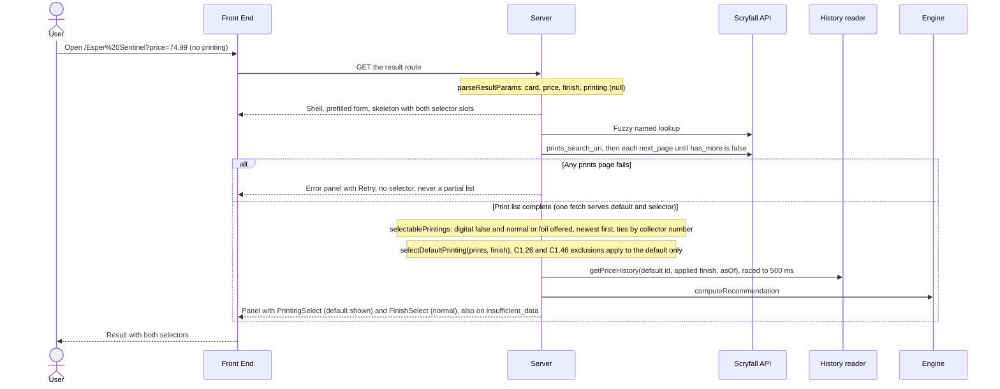

# S2.3 — Printing & finish selector on the result page

> Story: [Notion S2.3](https://app.notion.com/p/3f1a7227e26f81928a2ceed9967f993c) · Design: [F2 Live Evaluation Integration](https://app.notion.com/p/394a7227e26f81b7b3ccf5f51168130c) (Approved, Josh 2026-10-08; §UI loading state, §Functionality input handling, §Default printing, W2 and its edge cases, §Fields set/finish rows and URL params, the S2.1d23 foil-default note) and [F1 Price Recommendation Engine](https://app.notion.com/p/394a7227e26f813e8e97f395b70c0eb3) (Approved, Josh 2026-10-08; finish fallback, UI-strings table: printing selector label, finish selector label, printing option, finish names) · Standards: [Development Standards](https://app.notion.com/p/394a7227e26f810e956ef0c76c907c95) (Draft; conventions, Testing, DoD) · PR: #14 · Critique: docs/critiques/C1-2026-10-04-phase1-designs.md#C1.08, C1.21, C1.26, C1.46, C1.52, C1.54 (rulings C1.06 = A, C1.08 = A, C1.28 = A, C1.46 = A) · docs/critiques/C2-2026-10-05-new-pages.md#C2-B.4, C2-B.7, C2-B.8, C2-B.9, C2-B.12, C2-B.13

## Objective
Add a printing selector and a finish selector to the result surface `/[card]?price=&finish=&printing=` (C1.06 = A, C1.08 = A), so a user can re-evaluate the same card against another printing or finish without going back to the entry form. The options come from the one prints fetch S2.1 already makes for the default printing; a switch is a query-only navigation (`printing=<scryfall card id>`, Josh's gate comment) that the server recomputes, with history loaded for the selected `(scryfall_id, applied finish)` key only, never blended. Finishes are normal and foil; etched stays hidden.

Out of scope: the `logRecommendation` call a switch makes (F2 W2 step 3) belongs to S5.1, which wires it into this story's single change handler (C2-B.4). The history reader stays S2.1's empty reader until S0.1 (pivot recorded on F2), so every live card is `insufficient_data` tonight; AC-7 and AC-8 are proven with a keyed fake reader.

## Endpoints
| Method | Path | Request | Response | Auth | Errors |
|--------|------|---------|----------|------|--------|
| GET | `/[card]` (S2.1's route, behaviour added) | path `card`; query `price`, `finish`, and new `printing` (a Scryfall card id, UUID) | 200 HTML. New: the ok panel (every kind, `insufficient_data` included) carries PrintingSelect and FinishSelect; with a selectable `printing`, that printing is evaluated instead of the default | none | `printing` malformed or repeated → the inline validation error and no Scryfall call (C1.52, AC-9); `finish=etched` → the same (AC-4, already S2.1's parser rule, now pinned); a well-formed id not in the card's print list, or one PrintingSelect does not offer (digital, etched-only) → the default printing, no call for that id (AC-9); any prints page failing → S2.1's error panel with no selector (AC-2); never a 500 |

No route writes anything (C1.28). No new route handler. `/api/prices/snapshot` is never called.

## Data Model
None. No schema change, no migration, no database read or write; `docs/architecture/erd.md` is unchanged. History is still read only through S2.1's `PriceHistoryReader`, keyed by `(scryfallId, appliedFinish, asOf)`.

## Sequence Diagrams

### W1: First render, the default selection (AC-1 to AC-4, AC-10)


### W2: Switch printing or finish (AC-5, AC-6, AC-8, AC-11, AC-12)
```mermaid
sequenceDiagram
    actor U as User
    participant FE as Front End
    participant SV as Server
    participant SF as Scryfall API
    participant HR as History reader
    participant EN as Engine
    U->>FE: Open a Listbox, arrow through options
    Note over FE: Arrow keys move the active option only, no navigation
    U->>FE: Commit with Enter or a click
    alt Same printing and finish as shown
        Note over FE: No navigation
    else A new selection
        Note over FE: nextSelection: a finish switch keeps the shown printing id; a printing without the current finish takes its first offered finish
        Note over FE: href = selectionHref(searchParams, change), query only, price unchanged, path never rebuilt
        FE->>SV: router.push(href) inside the shared transition, focus request for the changed control
        Note over FE: Skeleton replaces the panel at once, both selector slots reserved, no submit marker written
        SV->>SF: Named lookup and every prints page
        SV->>HR: getPriceHistory(selected id, applied finish, asOf) only
        Note over SV,HR: Never blended with another printing or finish
        alt Foil chosen and the printing has no foil price
            Note over SV: Applied finish normal (C1.21), fallback notice, FinishSelect still shows Foil
        end
        SV->>EN: Recompute
        SV-->>FE: New panel and selectors
        FE-->>U: Focus back on the control that changed
    end
```

### W3: Hand-edited or stale URLs (AC-4, AC-9)
```mermaid
sequenceDiagram
    actor U as User
    participant FE as Front End
    participant SV as Server
    participant SF as Scryfall API
    participant HR as History reader
    U->>FE: Open a URL with printing or finish set by hand
    FE->>SV: GET the result route
    alt printing malformed or repeated, or finish etched
        SV-->>FE: Prefilled form with the inline validation error, no Scryfall call
    else Params valid
        SV->>SF: Named lookup and every prints page
        alt printing absent from the print list, or not offered (digital, etched-only)
            Note over SV: Default printing, no lookup or history read for that id
        else printing offered
            Note over SV: That printing is evaluated
        end
        alt URL finish not among the printing's finishes
            Note over SV: C1.21 unchanged: foil falls back to normal with the notice, normal is insufficient_data
        end
        SV->>HR: History for the evaluated printing and applied finish only
        SV-->>FE: Panel; FinishSelect value is the URL finish, its options the printing's finishes
    end
```

## Test Manifest
Shared fixtures: `src/lib/__fixtures__/esper-sentinel-prints.ts` (S2.1's) gives the sld #2123 entry its real Scryfall id, `f8b6c532-b837-42b6-9ed2-0231d0779626` (checked live 2026-10-10: sld 2123, finishes `["foil"]`, set_type box), so AC-9's fixture URL is literal; it also gains exported ids for each entry, an etched-only entry builder and a two-page variant (`ESPER_PRINTS_PAGE_1` with `has_more: true` and `next_page`, `ESPER_PRINTS_PAGE_2` with `has_more: false`). `src/lib/__fixtures__/keyed-history.ts` (new) holds a fake `PriceHistoryReader` keyed by `(scryfallId, finish)` with three divergent series, recording every call.

| ID | Test | Type | Covers | Notes |
|----|------|------|--------|-------|
| T1 | `src/lib/evaluation/result-params.test.ts`, `printing`: absent and `printing=` → `printing: null`; the canonical sld id → that id; the same id upper-cased → lower-cased; "abc", the id without dashes, with a trailing space, 37 characters, wrapped in braces, "sld-2123", "../x" and "%00" → `form` with the error; repeated `printing` → `form` with the error; a malformed `printing` with a blank price → `form` with the error; the `paramsKey` differs between no printing, printing A and printing B, and is equal for the upper- and lower-case id; `finish=etched`, `Foil` and repeated `finish` → `form` with the error; the AC-9 URL (`printing=f8b6c532-…&finish=normal&price=74.99`) → `ok` with that printing and finish normal. S2.1's "printing is ignored until S2.3" test is replaced | unit | AC-4, AC-9 | C1.52 |
| T2 | `src/lib/printings.test.ts`, `offeredFinishes`: `["nonfoil","foil","etched"]` → `["normal","foil"]`; `["foil","nonfoil"]` → `["normal","foil"]` (normal always first); `["foil"]` → `["foil"]`; `["nonfoil"]` → `["normal"]`; `["etched"]`, `[]`, a missing or non-array `finishes`, and non-string entries → `[]`; the result never holds "etched" | unit | AC-4 | |
| T3 | `printings.test.ts`, `selectablePrintings` on the Esper Sentinel fixture: exactly the seven paper ids (sld #2123 box, pmh2 #12s promo, plst, mh2 #328, h2r, mh2 #12, wc21 memorabilia); j21 (digital) absent; an added etched-only printing and one with `digital` undefined absent; mh2 #12 and mh2 #328 are separate entries; order is `released_at` newest first, then collector number numeric-aware ("4" < "12" < "12s" < "328", "9" < "10", "★"-suffixed after its number), then id; an id repeated across pages appears once (first kept); an entry without a string `id`, `set`, `set_name`, `collector_number` or `released_at` is left out; the input array is not mutated; 50 seeded shuffles of the input give the same output | unit | AC-1, AC-2 | Exclusions apply to the default only (C1.26, C1.46) |
| T4 | `src/lib/selection-href.test.ts`, `selectionHref(searchParams, change)`: from `price=74.99` and `{ printing: MH2_12_ID, finish: "foil" }` → exactly `?price=74.99&finish=foil&printing=f3537373-ef54-4578-9d05-6216420ee349`; the price kept verbatim and encoded (`$74.99` → `price=%2474.99`, `1,234.50` → `price=1%2C234.50`); an existing `finish` and `printing` replaced; unknown params (`utm_source`, `card`, `next`) dropped; a repeated `price` keeps the first; the href starts with `?` and holds no `/`; resolving it against each S2.4 AC-4 URL (`/Fire%20%2F%2F%20Ice?price=2`, `/%2B2%20Mace?price=0.25`, `/Question%20Elemental%3F?price=3`, `/Lim-D%C3%BBl's%20Vault?price=1`, `/Esper%20Sentinel?price=74.99`) with `new URL` keeps `pathname` byte-identical, and S2.1's `parseResultParams` on the resolved segment and query gives the same card and cents with the new printing and finish; works with `URLSearchParams` and Next's read-only variant; never mutates its input | unit | AC-5 | C2-B.7: the path segment is never rebuilt |
| T5 | `selection-href.test.ts`, `nextSelection(shown, change, options)`: a finish change from a default render returns the shown printing's id with the new finish; a printing change keeps the finish when that printing offers it; mh2 #12 / normal → sld #2123 (foil only) gives foil; plst (normal only) from foil gives normal; a printing offering both from foil keeps foil; the shown printing again, or the shown finish again, → null (no navigation); an id not in `options` or a finish the printing does not offer → null; never returns etched | unit | AC-6 | Pure rule for the handler |
| T6 | `src/lib/evaluation/build-evaluation.test.ts`, the default selection: no `printing` → mh2 #12 evaluated, `selection.options` equal `selectablePrintings(prints)` in order, `selection.printingId` mh2 #12, `selection.offeredFinishes` `["normal","foil"]`, `requestedFinish` normal; `finish: "foil"` → mh2 #12 / foil; `getAllPrintings` called exactly once per evaluation, and through the real client with `fetch` mocked the prints URL is fetched exactly once (one fetch serves the default and the selector) | unit | AC-1, AC-3 | |
| T7 | `build-evaluation.test.ts`, an explicit printing: mh2 #328 → mh2 #328 evaluated and the reader called once with `(mh2 #328, "normal", asOf)`; the sld id with finish normal → sld #2123 evaluated, offered `["foil"]`, kind `insufficient_data` (no normal price, C1.21), reader called with `(sld, "normal")`; a well-formed id of another card, j21's id (digital) and an etched-only printing's id → the default mh2 #12, the reader called only with mh2 #12's id, and `fetch` never called with `/cards/<that id>` | unit | AC-9 | |
| T8 | `build-evaluation.test.ts`, pagination through the real `getAllPrintings` (`fetch` mocked): page 1 (`has_more: true`, `next_page`) and page 2 (`has_more: false`) → options from both pages in T3's order; page 2 answering 503, an HTML 502, a rejected fetch, `has_more` without `next_page`, or a `next_page` off api.scryfall.com, and page 1 answering 503 → `{ status: "error" }` with one `scryfall_failed` log, 0 reader and engine calls, and no `selection` | unit | AC-2 | S2.1d7's no-partial-list rule |
| T9 | `build-evaluation.test.ts` with `keyed-history.ts`, never blended: divergent series for (A = mh2 #12, normal) 30 flat days, (A, foil) a 20-day rising ramp and (B = mh2 #328, normal) 14 days with a wide range; for each selection the reader's `getPriceHistory` is called exactly once, with exactly that key; `signals.snapshotCount30d`, `range30dCents` and `slope30dPct`/`trendDirection`, and the trend tile from `signalTiles`, equal `computeRecommendation` run on that key's series alone and differ from the other two keys' values. Fallback: printing A with `usd_foil` null and foil requested → reader called with `(A, "normal")`, `appliedFinish` normal, `requestedFinish` foil, `signals.fallbackNotice` true (when the kind is not insufficient) | unit | AC-7, AC-8 | History is read for the applied finish (C1.21) |
| T10 | `src/components/printing-select.test.tsx` (RTL): a button named by `UI_COPY.printingLabel` (`getByRole("button", { name: /^Printing/ })`); its text is the shown option's label; opening lists exactly the given labels in order ("Modern Horizons 2 (MH2) · #12" for mh2 #12); a shown printing not among the options still shows its label and no option is `aria-selected`; three ArrowDown presses call `onCommit` 0 times and Enter then exactly once with the active option's id; a click commits once; Escape commits nothing; no option text or label is a literal in the component (T16) | component | AC-1, AC-11 | Headless UI Listbox (C2-B.12) |
| T11 | `src/components/finish-select.test.tsx` (RTL): a button named by `UI_COPY.finishLabel`; options are exactly the offered finishes as `FINISH_LABELS` ("Normal", "Foil" or "Foil" alone), never "Etched"; the value shows the requested finish's label even when not offered (AC-9: value "Normal", one option "Foil"); with no offered finish the button is disabled; three ArrowDown presses 0 commits, Enter 1 | component | AC-4, AC-9, AC-11 | |
| T12 | `src/components/selection-controls.test.tsx` (router and `useSearchParams` mocked, inside `ResultNavigationProvider`): from a default render at `?price=74.99`, choosing Foil pushes exactly `?price=74.99&finish=foil&printing=<mh2 #12>` once; from mh2 #12 / Normal, choosing sld #2123 pushes `…&finish=foil&printing=<sld>`; choosing plst from Foil pushes `finish=normal`; choosing the shown option pushes nothing; three ArrowDown presses then Enter push exactly once; after a switch `sessionStorage` holds no `mm:submit:` key (S2.4's marker is for form submits only); the push happens inside the shared transition (`ResultSlot` shows the skeleton while it is pending); after a switch the remounted control's button is `document.activeElement` and the other control's is not; a form-initiated `navigate` clears the request, so a later mount takes no focus; a `refresh` clears it too | component | AC-5, AC-6, AC-11, AC-12 | The single change handler S5.1 extends |
| T13 | `src/app/[card]/result-view.test.tsx`: an ok evaluation renders both selectors inside `.mm-selector-row`, the printing option labels equal `printingLine` of each option and the header's set line equals the shown option's label; the `insufficient_data` panel renders both selectors (AC-10); foil requested with no foil price renders the fallback notice and FinishSelect's value "Foil" (AC-8); the error, ambiguous, not_found and invalid views render no selector and no `listbox` button | component | AC-8, AC-10 | S2.1 helpers gain `selection` |
| T14 | `src/app/[card]/page.test.tsx` (page awaited, deps injected, `fetch` mocked): `?price=74.99&printing=abc`, `&printing=<id>&printing=<id>` and `&finish=etched` each render the form with `UI_COPY.validationError` and `fetch` called 0 times; the AC-9 URL renders the sld #2123 header, FinishSelect value "Normal" with the one option "Foil", and the `insufficient_data` panel with both selectors; the Suspense key changes with `printing` alone, so a switch remounts the boundary; a failing second prints page renders the error panel with Retry and no selector button | component | AC-2, AC-4, AC-9, AC-10 | |
| T15 | `src/app/[card]/result-slot.test.tsx`, `panel-skeleton` and `result-css.test.ts`: a pending switch shows `PanelSkeleton` at once with two `[data-skeleton-part=selector]` inside `.mm-selector-row`, and the previous panel and selectors are gone; in `result.css` `.mm-selector-row` is a two-track grid with a fixed `height`, and `.mm-selector` and `.mm-skeleton-selector` each fill their track (`height: 100%`), under every breakpoint that restyles the row; no `className` in the three new TSX files is a template literal or string concatenation (AST), so Prettier's Tailwind plugin cannot trim a fragment (S2.4 ADV.1) | component, unit | AC-12, AC-5 | Layout shift measured in T18 |
| T16 | `src/app/[card]/client-boundary.test.ts`: "the scan sees this story's client modules" lists `printing-select.tsx`, `finish-select.tsx` and `selection-controls.tsx`, and no client module reaches the engine or `copy.ts` (option labels are built on the server); `tests/contract/entry-points-copy.test.ts`'s scan list gains the three files and `panel-skeleton.tsx`, with no letter-bearing JSX text or text attribute | unit | AC-5, AC-11 (C1.54) | RSC payload carries no engine code |
| T17 | `scripts/test-report.test.ts`: `featureOf` maps `src/lib/selection-href.test.ts`, `src/components/printing-select.test.tsx`, `src/components/finish-select.test.tsx` and `src/components/selection-controls.test.tsx` to F2; `docs/test-report.md` has no Unmapped row | unit | DoD 3 | S2.3d11 |
| T18 | `npm run lint`, `npm run build` and `npm test` exit 0 on Node 22 locally and every PR check is green in CI; `npm run test:report` lists T1–T17's files with no Unmapped. Local `next start` (production build, live Scryfall, empty reader) in the Browser pane: `/Esper%20Sentinel?price=74.99` shows both selectors (mh2 #12 / Normal, the `insufficient_data` panel); choosing Foil lands on `?price=74.99&finish=foil&printing=f3537373-…` with focus on the Finish button; choosing sld #2123 from Normal lands on Foil; the AC-9 URL renders sld #2123 with "Normal" shown and "Foil" offered; `?price=74.99&printing=abc` renders the validation string; one switch on each of Fire // Ice, +2 Mace, Question Elemental? and Lim-Dûl's Vault lands on the same `h1` with the new printing's set line; `getBoundingClientRect()` of `.mm-selector-row` in the skeleton and in the settled panel match (height and both tracks); `.next/static` holds no engine string. Mutations, each run and reverted: `selectablePrintings` without the digital filter fails T3; `selectionHref` rebuilding the path fails T4; `nextSelection` dropping the shown printing on a finish switch fails T5 and T12; history read for the requested instead of the applied finish fails T9; the same-selection check removed fails T12; the focus request never consumed fails T12; a template-literal `className` fails T15 | functional | AC-1 to AC-12 | Standards DoD 4; local build stands in for the preview (S2.3d10) |

### Evidence commands (Node 22, repo root)
```bash
source ~/.nvm/nvm.sh && nvm use 22 >/dev/null
# AGENTS.md Databases limit: `npm test` runs S1.1's integration project, so check hosts first.
{ env; cat .env* 2>/dev/null; } | grep -oE 'postgres(ql)?://[^[:space:]"]+' | sed -E 's#^[^@]*@##; s#[:/?].*##' | sort -u
{ env; cat .env* 2>/dev/null; } | grep -oE 'postgres(ql)?://[^[:space:]"]+' | grep -oiE '[?&]host(addr)?=[^&#]*' | sort -u
npm run lint
npm run build
npx vitest run src/lib/printings.test.ts src/lib/selection-href.test.ts src/lib/evaluation 'src/app/[card]' src/components tests/contract scripts/test-report.test.ts
npm test
npm run test:report   # regenerate and commit docs/test-report.md
# Functional evidence: production build on localhost, live Scryfall, no database
npx next start -p 3100 &
for p in 'Esper%20Sentinel?price=74.99' 'Esper%20Sentinel?price=74.99&finish=foil' 'Esper%20Sentinel?price=74.99&finish=normal&printing=f8b6c532-b837-42b6-9ed2-0231d0779626' 'Esper%20Sentinel?price=74.99&printing=abc' 'Esper%20Sentinel?price=74.99&finish=etched'; do echo "== $p"; curl -s "http://localhost:3100/$p" | grep -oE 'mm-card-set[^<]*<[^<]*|Enter a price from[^<]*|aria-labelledby="[^"]*"' | head -4; done
grep -rlE 'only \{n\} price snapshots|askingPriceCents must be an integer' .next/static || echo "no engine strings in .next/static"
```

## Results                                      <!-- filled in Review; tests are authored in Testing, run here -->
| ID | Pass/Fail | Evidence |
|----|-----------|----------|
| T1 | Pass | `src/lib/evaluation/result-params.test.ts` "the printing param (T1)": absent and `printing=` → null; the sld id and its upper-cased form → the lower-case id; "abc", no dashes, leading/trailing space, 37 chars, braces, a lone space, "sld-2123", "../x", "%00", NUL and a non-hex UUID shape → the form with the error; repeated (equal or not) → error; malformed with a blank or missing price → error; paramsKey distinct for none / A / B and equal across case; etched, Foil and repeated finish with a valid printing → error; the AC-9 URL → ok. S2.1's "printing is ignored until S2.3" test removed |
| T2 | Pass | `src/lib/printings.test.ts` "offeredFinishes (T2)": 11 cases, normal always first, etched never, malformed `finishes` → [] |
| T3 | Pass | `printings.test.ts` "selectablePrintings … (T3)" and "compareCollectorNumbers (T3)": the seven paper ids in order sld, plst, wc21, h2r #4, mh2 #12, pmh2 #12s, mh2 #328; j21, an etched-only and a `digital: undefined` printing absent; ties by released_at, collector number ("4" < "9" < "10" < "12" < "12s" < "12★" < "328"), id; repeated id keeps the first; unlabellable and non-object entries skipped; input not mutated; 50 seeded shuffles identical |
| T4 | Pass | `src/lib/selection-href.test.ts` "selectionHref (T4)": the exact AC href; `$74.99` → `price=%2474.99`, `1,234.50` → `price=1%2C234.50`; finish/printing replaced, `utm_source`/`card`/`next` dropped; repeated price keeps the first; `?`-led, no `/`; read-only params object; input unmutated; the five S2.4 AC-4 URLs keep `pathname` byte-identical and parse to the same card and cents with the new selection |
| T5 | Pass | `selection-href.test.ts` "nextSelection (T5)": finish switch keeps the shown id; mh2 #12 / normal → sld gives foil; plst from foil gives normal; both-finish printing keeps foil; same printing/finish, unknown id, unoffered finish → null; the AC-9 state; never etched |
| T6 | Pass | `src/lib/evaluation/build-evaluation.test.ts` "the default selection (T6)": mh2 #12 / normal, options = `selectablePrintings` in order with offered finishes; foil → mh2 #12 / foil; `getAllPrintings` once; through the real client exactly two fetches (named, prints) |
| T7 | Pass | `build-evaluation.test.ts` "an explicit printing (T7)": mh2 #328 read once for `(mh2 #328, normal)` at 7120 cents; sld + normal → offered `["foil"]`, insufficient_data, read `(sld, normal)`; another card's id, j21 and an etched-only id → mh2 #12, reader only for mh2 #12, no fetch naming the id; promo chosen is evaluated; repeated id uses its first copy; the named-card fallback keeps its finishes with empty options |
| T8 | Pass | `build-evaluation.test.ts` "pagination and page failures (T8)": two pages → T3's order, three fetches; page 2 503 / HTML 502 / rejected, `has_more` without `next_page`, an off-host `next_page`, page 1 503 → `{ status: "error" }`, one `scryfall_failed`, reader and engine 0 calls |
| T9 | Pass | `build-evaluation.test.ts` "history is never blended (T9)" with `src/lib/__fixtures__/keyed-history.ts`: for (mh2 #12, normal) 30 flat, (mh2 #12, foil) 20-day ramp and (mh2 #328, normal) 14 wide days, one read with exactly that key; count, range, slope, direction and the trend tile equal the real engine on that series alone, and the three keys differ; fallback with `usd_foil` null reads `(A, normal)` only, fallbackNotice true |
| T10 | Pass | `src/components/printing-select.test.tsx` (8 tests): aria-labelledby = [label, button]; labels in order with the shown one selected; a shown printing outside the options selects none; 3 ArrowDown → 0 commits, Enter → 1 (`mh2-12`); ArrowUp never commits; click commits once; Escape commits nothing; no options → disabled |
| T11 | Pass | `src/components/finish-select.test.tsx` (9 tests): Normal/Foil, Foil, Normal; an etched entry forced by a cast never renders; AC-9 value Normal with one option Foil; none offered → disabled; 3 ArrowDown → 0, Enter → 1; click → 1 |
| T12 | Pass | `src/components/selection-controls.test.tsx` (19 tests): exact hrefs for Foil, sld (→ foil), plst from Foil (→ normal) and a verbatim `%24` price, each pushed once with `{ scroll: false }` (Deviation 3); shown option → no push; 4 ArrowDown then Enter → one push; no `mm:submit:` key; skeleton at once with two selector slots, old controls gone; focus on the remounted Finish / Printing button and not the other; the request is taken once. After the adversarial review: a switch that lands on the error panel focuses Retry and a later Back or Forward takes no focus (ADV.2, replacing the control test that pinned the leak); Retry takes no focus without a switch; selectors focus only on the page the switch pushed; a request no panel took still focuses the selectors on that page (the control); a form submit and a refresh each clear it; a switch resets an unsubmitted price and card edit to the URL's values, and an edit typed during the switch survives (ADV.6) |
| T13 | Pass | `src/app/[card]/result-view.test.tsx` "the selectors in the panel (T13)": both selectors in `.mm-selector-row`, option labels = `printingLine` of each option, the selected one = the header's set line; insufficient_data (sld) renders both; foil fallback renders the notice with FinishSelect "Foil"; error/ambiguous/not_found/invalid render no selector or listbox button |
| T14 | Pass | `src/app/[card]/page.test.tsx` "the printing param on the page (T14)": `printing=abc`, a repeated printing and `finish=etched` → the form with `UI_COPY.validationError`, fetch 0; the AC-9 URL → sld header, FinishSelect Normal with the one option Foil, insufficient_data, two fetches; the Suspense key changes with printing alone; the panel query carries the lower-cased printing; a failing page 2 → error panel with Retry, no selector, one log; a default render shows mh2 #12 / Normal |
| T15 | Pass | `src/app/[card]/result-slot.test.tsx` "a selector switch (T15)": skeleton at once, two `[data-skeleton-part=selector]` as the row's only children, previous panel and controls gone; `result-css.test.ts`: `.mm-selector-row` a two-track grid at `height: 60px`, `.mm-selector` and `.mm-skeleton-selector` `height: 100%`, no rule in either stylesheet changes those (the 760 px breakpoint keeps two tracks), label row 12 + gap 8 + 40 px button = 60, no literal colour; every `className` in the five selector TSX files is a plain string (AST, with a self-test). After the adversarial review: "the stale banner across a switch (ADV-1)" (4 tests: PanelSkeleton's banner on request only, the same element, text and place, aria-hidden; the pending skeleton and the landed panel hold the same thing above the grid; a Back or Forward's Suspense fallback holds it; a fresh panel drops it again; the first load's fallback has none); "the selector lists stay inside the row (ADV-4)" (4 tests) |
| T16 | Pass | `client-boundary.test.ts`: the scan lists the three selector modules; their closure holds `ui-copy.ts` and `selection-href.ts` but no engine, `copy.ts` or `src/lib/evaluation/` module. `tests/contract/entry-points-copy.test.ts`: the three selectors, `select-chevron.tsx` and `panel-skeleton.tsx` hold no user-facing literal |
| T17 | Pass | `scripts/test-report.test.ts`: the four new test files map to F2; the committed `docs/test-report.md` lists them and has no `\| Unmapped \|` cell. `npm run test:report` "✅ All green", 2251 tests, F2 40 files 1232 |
| T18 | Pass | Local, Node 22: host check `localhost` only (`.env.example`), with the throwaway Postgres 14.8 on `127.0.0.1:55432` inline; the `host=` check nothing. `npm run lint` exit 0; `npm run build` green; `npm test` 78 files, 2249 passed, 2 skipped, type errors none; `.next/static` holds no engine string. `next start` on :3100 (live Scryfall, empty reader): `/Esper%20Sentinel?price=74.99` → MH2 #12 / Normal, insufficient_data, six live options; `&finish=foil` → Foil; the AC-9 URL → SLD #2123, Normal shown, offered `["foil"]`; `&printing=abc` and `&finish=etched` → the validation string. Browser pane: Finish → Foil by keyboard landed on `?price=74.99&finish=foil&printing=f3537373-…` with focus on the Finish button; Printing → SLD #2123 from Normal landed on `finish=foil` with focus on Printing; one switch each on Fire // Ice (DMR #215 → MH2 #290), +2 Mace (one printing, so Normal → Foil), Question Elemental? (UNH #43 → #43★, foil only, so foil) and Lim-Dûl's Vault (MB2 #87 → SLC #1996) kept the path byte for byte and the `h1`, with the new set line and focus on the changed control. `.mm-selector-row` skeleton vs settled: 640 × 60 with tracks 428 and 200 (desktop) and 343 × 60 with 203 and 128 (375 px, no horizontal overflow, scroll position 303.5 kept). The row's *position* differed by 61.6 px (the stale banner, Deviation 8) until ADV.1; re-measured after the fix on `next start` with a MutationObserver on the slot: `.mm-selector-row` top 679.3 px and `.mm-result-grid` top 288.6 px (712 px wide, Finish → Foil), and 408.6 px and 328.6 px (1280 px, Printing → SLD #2123), identical in the settled panel, the pending skeleton, the Suspense fallback and the landed panel, with focus on the changed control. ADV.4 at 375 px on Sol Ring (139 options): the printing list spans 16–359 px, every option's right edge ≤ 354 px (≤ innerWidth − 16), the longest label ("Commander Legends: Battle for Baldur's Gate (CLB) · #871") wraps to two lines, document scrollWidth 375; the finish list sits in its track (231–359 px). Mutations, each run and reverted: no digital filter → T3 8 failed; path rebuilt → T4 13 failed; finish switch dropping the printing → T5 2 and T12 1 failed; history for the requested finish → T9 and S2.1's fallback tests 3 failed; same-printing check removed → T12 1 failed (same-finish too); focus request never taken → T12 4 failed; a template-literal className → T15 1 failed. CI [run 38101134661](https://github.com/ayfor/mox-market/actions/runs/38101134661) on `7c61674`: "lint + build + test" green in 2m13s (`0000_baseline` applied, 78 files, 2249 passed, 2 skipped, type errors none); Vercel preview green |

## Deviations                                   <!-- what changed from the plan and why -->
1. **`takeFocus()` takes no argument (S2.3d7).** `SelectionControls` takes the request once, in one mount effect, and focuses the matching button through a ref, so the selects stay presentational and no button needs its own hook. Same behaviour: a switch's request is taken by the next mount of the selectors; a plain `navigate` or a `refresh` clears it.
2. **A fourth new TSX file, `src/components/select-chevron.tsx`.** The decorative chevron both selects share (an `aria-hidden` SVG, no text, no hooks). It is in T15's className scan and T16's literal scan.
3. **A switch pushes with `{ scroll: false }`.** `navigate(href, { focus })` calls `router.push(href, { scroll: false })`; form submits keep Next's default. Without it Next scrolls a query change to the top, and on narrow screens the focus restore then scrolls back to the control. Measured on a 375 px viewport: scroll position 303.5 before and after a switch. T12 pins the option.
4. **S2.4's "one builder" test allows the second builder.** `src/lib/result-href.test.ts` now expects `?price=` literals in exactly `result-href.ts` and `selection-href.ts` (AC-5 requires `selectionHref` in its own file).
5. **`printingLine` takes `Pick<…, "set" | "set_name" | "collector_number">`**, so the server labels options with the same function as the header (S2.3d6).
6. **`ListboxOptions` is `modal={false}`.** The lists render inline under their buttons (no anchor or portal), so Headless UI's scroll lock and inert-others are off; outside clicks and Escape still close them.
7. **T12's focus tests re-render the page with the new key while the navigation is pending, then settle**, as the router commits the new tree and `isPending = false` together. Settling first remounts the old controls with the old key, a test-only artefact.
8. **Resolved by ADV.1: the stale banner moved the selector row.** Skeleton and settled rows matched in size and tracks, but S2.1's stale banner sat at the top of the ok panel and not in the skeleton, so while `syncStale` was true (every card until S0.1) the row sat 61.6 px lower once the panel landed. The skeletons now reserve the banner the last panel showed (ADV.1); the panel's own layout is unchanged.
9. **T17 adds a check on the committed report** (the four new files listed, no `| Unmapped |` cell), and the report's e2e note names S2.3d10.
10. **The adversarial fixes reach beyond S2.3d1's file list.** New: `src/lib/scryfall-id.ts` (ADV.5, the id pattern `parsePrinting` and `selectablePrintings` share). Edited although S2.3d1 listed them as S2.1's or S2.4's: `src/app/[card]/retry-button.tsx` (takes a switch's focus request, ADV.2), `src/components/entry-form.tsx` (resets unsubmitted edits on a switch, ADV.6), `src/app/[card]/result-slot.tsx` and `page.tsx`'s Suspense fallback (`SlotSkeleton`, ADV.1), and `buildEvaluation`'s `loadMarketSnapshot` call (`withOfferedPrices`, ADV.3); `load-market-snapshot.ts` itself is unchanged. S2.1's "a different query while pending supersedes it" test now settles its two pushes: React 19 entangles every later async transition with one left pending, which kept the ADV.1 tests' `isPending` true. No locked string and no `RECOMMENDATION_PARAMS` value changed; no new dependency.

## Decisions                                    <!-- S#.#d1, S#.#d2 … one line each; design-level decisions stay in Notion -->
- **S2.3d1 (scope).** New: `src/lib/selection-href.ts` (`selectionHref`, `nextSelection`), `src/components/printing-select.tsx`, `src/components/finish-select.tsx`, `src/components/selection-controls.tsx` (the single change handler), `src/components/selection-controls.css`, `src/lib/__fixtures__/keyed-history.ts` and the tests in the manifest. Edited: `src/lib/printings.ts` (adds `offeredFinishes` and `selectablePrintings`; `selectDefaultPrinting` unchanged), `src/lib/evaluation/result-params.ts` (the `printing` param only, plus `paramsKey`), `src/lib/evaluation/build-evaluation.ts` (after resolution only: the selected printing and the `selection` field), `src/app/[card]/page.tsx` (passes `printing` into the query), `src/app/[card]/result-view.tsx` (fills the reserved `.mm-selector-row`), `src/app/[card]/panel-skeleton.tsx` and `result.css` (selector slot geometry), `src/components/result-navigation.tsx` (the focus request, S2.3d7), `src/lib/__fixtures__/esper-sentinel-prints.ts` (S2.3d9), `tests/contract/entry-points-copy.test.ts` and `src/app/[card]/client-boundary.test.ts` (scan lists), `scripts/test-report.mjs` and its test, `docs/test-report.md`, and S2.1's and S2.4's tests that build ok evaluations or mock `next/navigation` for a rendered ok panel (they gain `selection` and `useSearchParams`). Not touched: `prisma/schema.prisma`, `src/app/layout.tsx` (S2.2), `src/app/page.tsx`, `landing-form.tsx`, `evaluate-client.tsx`, `entry-form.tsx` and `src/lib/result-href.ts` (S2.4), `src/lib/scryfall.ts`, the named-lookup and miss branch of `buildEvaluation` (S2.4d8), every `RECOMMENDATION_PARAMS` value and every locked string in `copy.ts`, `ui-copy.ts` and `legal.ts`, `docs/specs/**`, and every harness file except `.cursor/hooks/active-story.json`. No new dependency: Headless UI 2.2.9 is already installed (C1.30).
- **S2.3d2 (`printing` param, AC-9, C1.52).** `parseResultParams` reads `printing` beside `price` and `finish`: absent or exactly empty is `null` (the default printing); otherwise it must match `/^[0-9a-f]{8}-[0-9a-f]{4}-[0-9a-f]{4}-[0-9a-f]{4}-[0-9a-f]{12}$/i` and is lower-cased (Scryfall ids are lower-case, so a hand-typed upper-case id still matches its printing); anything else, or a repeated `printing`, is the form with the error, before any Scryfall call, also when the price is blank (as S2.1 does for `finish`). `ok` gains `printing: string | null`, and `paramsKey` becomes `card|cents|finish|printing` (empty for null), so a switch remounts the keyed Suspense. **Choices Josh can overturn:** a malformed `printing` shows the price validation string, because F1's table has no printing string and adding one is a locked-copy change (the S2.1d5 precedent for `finish`); the resubmitted form drops `printing` and `finish` (S2.4's `resultHref`), so it lands on the default.
- **S2.3d3 (`selectablePrintings`, `offeredFinishes`; AC-1, AC-2, AC-4).** In `src/lib/printings.ts`, pure. `offeredFinishes(printing)` is `normal` when `finishes` holds `nonfoil`, then `foil` when it holds `foil`, in that order, never etched. `selectablePrintings(printings)` keeps every entry with `digital === false`, at least one offered finish, and string `id`, `set`, `set_name`, `collector_number` and `released_at` (an entry the option cannot label is left out rather than shown blank); it keeps the first of any repeated id, and sorts by `released_at` descending, then collector number ascending (leading digits compared as integers, then the rest by code unit, so "4" < "12" < "12s" < "328"; no `localeCompare`, so the order does not depend on ICU), then id. Promo, box, memorabilia, token and minigame printings stay selectable: C1.26 and C1.46's exclusions shape only the default.
- **S2.3d4 (`buildEvaluation`, AC-3, AC-7 to AC-9).** `EvaluationQuery` gains `printing?: string | null`. After the prints fetch (S2.4's lookup and miss branch untouched), `selectable = selectablePrintings(printings)`; when `query.printing` names an entry in it, that printing is evaluated, otherwise S2.1's `pickPrinting` (S2.1d23) picks the default, so an unknown, digital or etched-only id never reaches Scryfall or the reader. `loadMarketSnapshot` is unchanged: it already reads history for `(printing.id, appliedFinish, asOf)` and applies C1.21, so a switch reads exactly one key and nothing is blended. The ok result gains `selection: { options, printingId, offeredFinishes }`, where `options` are `{ id, set, set_name, collector_number, finishes }` for each selectable printing and `offeredFinishes` are the evaluated printing's (`offeredFinishes(printing)`, so the named-card fallback has them too). One prints fetch serves both the default and the selector.
- **S2.3d5 (`selection-href.ts`, AC-5, AC-6; C2-B.7).** Client-safe and pure. `selectionHref(searchParams, { printing, finish })` returns `"?price=" + encodeURIComponent(price) + "&finish=" + finish + "&printing=" + encodeURIComponent(printing)`, with `price` the URL's first `price` value verbatim (the asking price is unchanged; the server normalises it as before) and every other parameter dropped. It is query-only, so `router.push` keeps the current path segment byte for byte and nothing re-encodes the card name (S2.4 AC-4's names stay one segment). `nextSelection(shown, change, options)` is the AC-6 rule: a finish change keeps the shown printing and writes its id; a printing change keeps the shown finish when the new printing offers it, else takes the printing's first offered finish (normal before foil); a change equal to what is shown, an unknown id or an unoffered finish is `null` (no navigation).
- **S2.3d6 (controls, AC-1, AC-4, AC-11; C2-B.12).** `PrintingSelect` and `FinishSelect` are client Headless UI `Listbox`es inside a `Field` with a visible `Label` (`UI_COPY.printingLabel`, `UI_COPY.finishLabel`), so arrow keys move the active option and only Enter or a click commits. They are presentational (`options`, `value`, `onCommit`). `SelectionControls` (client) renders both and owns the single change handler, `commitSelection(change)`: `nextSelection`, then `selectionHref(useSearchParams(), …)`, then the shared `navigate(href, { focus })`; S5.1 adds its `logRecommendation` call there (C2-B.4). It writes no submit marker: S2.4's marker means "a form submit", and a switch is not one. The server builds every option label with S2.1's `printingLine` (`UI_COPY.printingOption`, "Modern Horizons 2 (MH2) · #12") and passes `{ id, label, finishes }`, so no client module imports `copy.ts`'s `fillTemplate` (T16) and the RSC payload carries strings only. When the shown printing is not among the options (only the named-card fallback can do this), PrintingSelect shows its label with no option selected. FinishSelect's value is the requested finish even when the printing does not offer it (AC-9); its options are the offered finishes; with none it is disabled. Long print lists (a basic land) render every option, bounded by S2.1's `MAX_PRINT_PAGES` (20 pages); no virtualisation.
- **S2.3d7 (focus and skeleton, AC-5, AC-12; C2-B.9).** The selectors live inside the keyed Suspense, so a switch unmounts the control just used. `ResultNavigation` (S2.1's provider, outside the boundary) gains a focus request: `navigate(href, { focus: "printing" | "finish" })` records it in a ref, a plain `navigate` or `refresh` clears it, and `takeFocus(control)` returns and clears it; each select's `ListboxButton` calls `takeFocus` on mount and focuses itself when it is the one. The pending skeleton already reserves two selector slots (S2.1d10); `.mm-selector-row` becomes a two-track grid (printing wider than finish) with a fixed height that both the real controls (label above a 40 px button) and `.mm-skeleton-selector` fill, so a switch shifts nothing (DOM measured in T18). Styling uses Headless UI's `data-focus`, `data-selected` and `data-disabled` attributes in `selection-controls.css` with whole class strings, never a conditional `className` template (S2.4 ADV.1's Prettier Tailwind-plugin trim; T15 pins it).
- **S2.3d8 (C1.21 belongs to the caller, AC-8).** The selectors never substitute a finish on price grounds: FinishSelect offers what `finishes` lists, and a foil choice on a printing whose `usd_foil` is null navigates with `finish=foil`; the server's `loadMarketSnapshot` applies normal pricing and history with the fallback notice. A normal choice on a foil-only printing (AC-9) stays normal and is `insufficient_data` (S2.1 AC-12).
- **S2.3d9 (fixtures).** S2.1's hand-built Esper Sentinel fixture keeps every price and flag but gives sld #2123 its real id, `f8b6c532-b837-42b6-9ed2-0231d0779626` (the old `11111111-…` id is referenced nowhere else), so AC-9's URL is used verbatim, and gains named id exports, an etched-only builder and the two-page split for AC-2. Live Scryfall (2026-10-10) also lists mh2 #12 and mh2 #328 on the same `released_at`, the collector-number tie AC-2 names.
- **S2.3d10 (verification, no Playwright).** As S2.4d13: RTL on every client component, `buildEvaluation` with injected deps and the real client over a mocked `fetch`, the awaited page, and functional evidence on a local production build (`next start`, live Scryfall, empty reader) driven in the Browser pane for the switches, focus and DOM measurements, because preview deployments sit behind Vercel authentication. **Choice Josh can overturn:** add Playwright for the switch journey.
- **S2.3d11 (report map).** F2's patterns in `scripts/test-report.mjs` gain `selection-href` in the `src/lib/(result-href|entry-submit)` group; `src/components/`, `src/lib/printings`, `src/lib/evaluation` and `src/app/[card]/` already map to F2. T17 pins it.
- **S2.3d13 (ADV.6, a switch resets unsubmitted form edits; Josh can overturn).** A switch evaluates the URL's card and price (AC-5), so the entry form's unsubmitted card and price edits are reset to the URL's values when a switch starts, rather than left beside a result they did not produce. `ResultNavigation` counts switches (navigations with a focus target) and `EntryForm` resets when the count changes; an edit typed after the switch survives its landing as before (S2.4 ADV-8). The alternative, keeping the edit, would need copy saying which price the panel used.
- **S2.3d14 (ADV.7, open for Josh).** Every `insufficient_data` panel says "try a different printing" (F1's locked sentence), which misleads for a card with one selectable printing and for the AC-9 state (a foil-only printing with Normal requested), where a different finish is the way forward. Unchanged: locked copy needs Josh's ruling. Proposal (the reviewer's): F1 UI-strings rows for "try a different finish" and for a no-alternative variant, chosen in `OkView` from `selection.options.length` and `selection.offeredFinishes`.
- **S2.3d12 (harness, logging).** Bitey commits `.cursor/hooks/active-story.json` = `{"story":"S2.3"}` on this branch and deletes it in the branch's last commit before the PR goes ready, with the WORKLOG line. Nothing is written to the database and nothing is logged to F5: S5.1 branches from `main` after this story and wires the switch's log call into `commitSelection`.

## Critique                                     <!-- entries from docs/critiques/ that touched this story; implementation-mode change list lands here -->
- **C1.08 = A** (major): the printing selector is its own story after S2.1; etched hidden in Phase 1 (AC-4, S2.3d3, S2.3d6).
- **C1.21**: the finish fallback belongs to the caller; the selector never substitutes a finish on price grounds (AC-8, S2.3d8).
- **C1.26, C1.46 = A**: the default excludes promo, memorabilia, token, minigame and box printings; the selector lists them (AC-1, S2.3d3).
- **C1.52**: `printing` validated as a UUID before any Scryfall call (AC-9, S2.3d2). **C1.54**: every selector string from the locked copy module (AC-11, T16). **C1.28 = A**: nothing written on render or switch.
- **C2-B.4** (the switch's log call is S5.1's, in this story's single change handler, S2.3d6), **C2-B.7** (a switch is query-only and never rebuilds the path, S2.3d5, T4), **C2-B.8 = A** (the selector label, option template and finish names are F1 UI-strings rows, already in `ui-copy.ts`), **C2-B.9** (focus returns to the changed control; the skeleton keeps both slots, S2.3d7), **C2-B.12** (Headless UI Listbox, no native `<select>`, T10–T12), **C2-B.13** (hand-edited states: unselectable id → default; URL finish outside the printing's finishes → C1.21 unchanged, FinishSelect shows it, AC-9, T7, T14).

### Adversarial review (2026-10-10, under the overnight directive)
An independent read-only reviewer checked the unhappy paths and the coverage of every case the feature presents. Seven findings; six fixed with tests, one left for Josh. Each fix was reverted on its own and its new test failed (mutation counts in the Session Log).
- **ADV.1** (major) — S2.1's stale banner (shown for every card until S0.1) sat in the ok panel but not in the skeleton, so every switch moved the selector row and the result grid 61.6 px when the panel landed, failing AC-12 (Deviation 8) → **fixed**: `ResultSlot`, outside the keyed Suspense, remembers whether the last settled panel showed the banner (`OkView` renders `StaleBannerReport`), and both skeletons, the pending one and the Suspense fallback (now `SlotSkeleton`), render the same `.mm-stale-banner` element and text, aria-hidden, above the grid. The banner stays in the server-rendered panel, so the first load is unchanged. The reviewer's other option, a page-level banner from its own freshness read, was not taken: it adds a second read per render and moves the banner onto the error and miss views, an S2.1 layout change. Tests: `result-slot.test.tsx` "the stale banner across a switch (ADV-1)"; T18 re-measured (Results).
- **ADV.2** (minor) — a switch that landed on a non-ok panel left focus on `<body>` and the focus request alive, so the next selectors to mount without the provider (a Back or Forward to another query) took it; T12's control test pinned that → **fixed**: the request records the href the switch pushed, and `SelectionControls` focuses only when the selection it shows gives that href (`selectionHref`), so a Back or Forward to another selection takes no focus and spends the request; `RetryButton` takes the request on mount and focuses itself, so a switch that lands on the error panel leaves focus on Retry. The reviewer's fix, clearing the request when `isPending` falls, was not used: on `next start` a switch commits the pending skeleton and then the keyed Suspense's fallback (two skeleton commits measured in T18), so the selectors mount after `isPending` is already false and that effect would drop every legitimate request. Tests: T12, the control test replaced by its inverse plus four more.
- **ADV.3** (minor) — `loadMarketSnapshot` chose the applied finish by price alone, so a printing whose `finishes` omit foil but whose `usd_foil` is set was priced and read as `(id, "foil")` while FinishSelect offered only Normal, against AC-9 → **fixed**: `buildEvaluation` passes `withOfferedPrices(printing)` (new in `printings.ts`), which drops a `usd` or `usd_foil` for a finish the printing does not offer, so the C1.21 fallback follows the finishes list; `loadMarketSnapshot` is unchanged. Tests: `printings.test.ts` "withOfferedPrices (ADV-3)"; `build-evaluation.test.ts` "the fallback follows the finishes list (ADV-3)" (plst with foil → normal applied, read `(plst, normal)` only, the notice; a stray `usd_foil` never read as foil; a stray `usd` on a foil-only printing → insufficient_data); `page.test.tsx`, the plst + foil URL: FinishSelect "Foil" with the one option "Normal", a buy panel with the fallback notice.
- **ADV.4** (minor) — the printing list was anchored to its own track with nowrap options and no max width, so at 375 px a long label ran past the viewport and the page shell's `overflow-x: hidden` cut off the set code and collector number → **fixed**: PrintingSelect's list is anchored to `.mm-selector-row` and spans both tracks, FinishSelect's is aligned to the row's right edge, and options wrap (`white-space: normal; overflow-wrap: anywhere`). Tests: `result-css.test.ts` "the selector lists stay inside the row (ADV-4)"; T18 on Sol Ring at 375 px (Results).
- **ADV.5** (minor) — `selectablePrintings` offered entries that could not survive the URL round trip: one without `name` (choosing it rendered the error panel), one with an upper-case id (silently the default, since `parsePrinting` lower-cases) and a non-UUID id (the validation error) → **fixed**: an offered printing needs a lower-case Scryfall UUID id and a string `name`; the pattern lives in `src/lib/scryfall-id.ts`, shared with `parsePrinting`, which still accepts any case and lower-cases it. Tests: `printings.test.ts` "an offered option evaluates to itself (ADV-5)"; `build-evaluation.test.ts` "every offered option round-trips through the URL to itself (ADV-5)".
- **ADV.6** (minor) — a switch evaluates the URL's price while the form kept an unsubmitted edit, so the field could read 70 beside a result for 74.99 with nothing saying which price was used → **fixed** under S2.3d13 (Josh can overturn): a switch resets the form's unsubmitted card and price edits to the URL's values; the asking price stays the URL's (AC-5). Tests: T12 "unsubmitted form edits on a switch (ADV-6)".
- **ADV.7** (minor) — every `insufficient_data` panel says "try a different printing", which is wrong for a card with one selectable printing (+2 Mace) and for the AC-9 state, where a different finish is the way forward → **not a defect in S2.3's code**: the sentence is F1's locked copy (AGENTS.md Thresholds and copy), so changing it needs Josh's ruling; open item S2.3d14 with the reviewer's proposal.


## Review                                       <!-- Josh's comments VERBATIM, each followed by a Disposition. One round for ordinary stories. -->
### Round 1 — Operator comments (verbatim)
Josh, 2026-10-10 02:49 (overnight directive): "alright we are going against the plan here in the interest of time. I am running you overnight. Set a goal to keep going and merging until you have completed the approved features. For each PR, perform an adversarial review prior to merge as a sub agent who is verifying the unhappy paths of the feature functionality and ensuring proper test coverage for cases presented by the feature. Also before merge, check the PR for other comments from ChatGPT and address them with updates if they present valid edge cases or errors in the implementation. Make any retroactive updates to the Notion docs if you need to pivot."

Plan approved under Josh's overnight directive, 2026-10-10 (see /Users/joshstubbington/Documents/bitey-a/notes/assets/night-run-2026-10-10.md)

### Disposition (Round 1)
- Plan approved under the directive. On that basis Bitey applied the `plan-approved` label to this PR. Notion S2.3 Status → In Progress, and its PR property → this PR.
- Choices Josh can overturn: a malformed `printing` shows the price validation string and an empty `printing=` means the default (S2.3d2); the switch keeps the URL's price text verbatim and drops other params (S2.3d5); visible labels above the controls, and the named-card fallback shown with no option selected (S2.3d6); a `refresh` clears the focus request (S2.3d7); no Playwright (S2.3d10). No new dependency.

## Session Log                                  <!-- append-only; one entry per agent session; newest last -->
### 2026-10-10 · bitey · S2.3
- Decided: plan compiled from the Notion story (Description, Sequence, AC-1 to AC-12, Notes: Owns, Does not touch, shared seam, Logging, History source), Design F2 (Approved: §UI loading state, §Functionality input handling, §Default printing, W2 and its edge cases, §Fields, the S2.1d23 note), Design F1 (Approved: finish fallback, UI-strings rows), the Standards page, the night-run directive, and S2.1's and S2.4's plans and code for the seams (S2.1d5, S2.1d7, S2.1d10, S2.1d23, D-7; S2.4d8, S2.4d13, ADV.1). Branch `story/S2.3-printing-finish-selector` from `main` at `daca5b4`. S2.3d1–S2.3d12. Live Scryfall checked read-only for the AC-9 id and the mh2 collector-number tie.
- Tried and dropped: a native `<select>` (C2-B.12: arrow keys commit on Windows and Linux); rebuilding the switch href with S2.4's `resultHref` (it drops `finish` and would re-encode the path, C2-B.7); reading the price from server props instead of the URL (AC-5 names `selectionHref(searchParams, change)`); a module-level focus flag (the provider outside the Suspense boundary already owns navigation, so the request lives there and is cleared by any other navigation); `localeCompare` with numeric collation for collector numbers (ICU-dependent order).
- Deviated: none.
- Open: the five choices under Disposition.
- Next: build per the manifest (T1–T18), then the adversarial review and the Codex review.
Evidence: plan commit on `story/S2.3-printing-finish-selector` · `npm test` not run (no code yet)

### 2026-10-10 · bitey · S2.3 (build)
- Decided: built per the manifest: the `printing` param (S2.3d2); `offeredFinishes`, `selectablePrintings` and `compareCollectorNumbers` (S2.3d3); the `selection` field in `buildEvaluation` (S2.3d4); `selectionHref` and `nextSelection` (S2.3d5); PrintingSelect, FinishSelect and SelectionControls with the focus request (S2.3d6, S2.3d7); the fixed-height selector row shared with the skeleton; the fixture ids and two-page split (S2.3d9); `keyed-history.ts`; the F2 report mapping (S2.3d11). S2.1's and S2.4's tests that render an ok panel gained `selection` and `useSearchParams`, and S2.1's paramsKey expectations gained the printing slot. T1–T17 written and green, then Notion S2.3 Status → Testing. T18 run on `next start` with live Scryfall and the Browser pane (Results), and the plan's seven mutations each failed and were reverted.
- Tried and dropped: settling a switch's navigation before re-rendering with the new key in T12 (it remounts the old controls, Deviation 7); `getByRole` names with the button text in jsdom (its name computation stops at the label, so T10/T11 assert `aria-labelledby` = [label, button] and a name starting with the label); `not.toMatch(/Unmapped/)` on the report (the failing test's own name lands in the report's failure list, so T17 matches table cells).
- Deviated: Deviations 1–9; 3 (scroll kept on a switch) is a behaviour change beyond the plan, the rest are scope notes.
- Open: Deviation 8 (the stale banner shifts the selector row 61.6 px until S0.1); the five choices under Disposition (Round 1).
- Next: the adversarial review, then the Codex review.
Evidence: commits `f41be99` (feature and tests), `d5de0ab` (scroll kept), `7c61674` (T17 and the report) · host check printed only `localhost`, the `host=` check nothing · `npm run lint` exit 0 · `npx prettier --check` on every changed file clean · `npm run build` green · `npm test` 78 files, 2249 passed, 2 skipped, type errors none (throwaway Postgres 14.8 on `127.0.0.1:55432`, stopped after) · `npm run test:report` "✅ All green", 2251 tests, no Unmapped · `.next/static` holds no engine string · CI [run 38101134661](https://github.com/ayfor/mox-market/actions/runs/38101134661) green on `7c61674` ("lint + build + test" 2m13s; Vercel preview green)

### 2026-10-10 · bitey · S2.3 (adversarial fixes)
- Decided: checked each of the reviewer's seven findings against the code; all seven are real. Fixed ADV.1–ADV.6 with tests (Critique, "Adversarial review"); ADV.7 is locked copy, left for Josh (S2.3d14). S2.3d13 (a switch resets unsubmitted form edits) is a call Josh can overturn. ADV.1 keeps the banner in the panel and has the skeletons reserve it; ADV.2 ties the focus request to the pushed href and lets Retry take it, because on `next start` the keyed Suspense's fallback commits after `isPending` falls, so clearing on that edge would drop every real request.
- Tried and dropped: the reviewer's `isPending`-edge clear for ADV.2 (above); a page-level banner with its own freshness read for ADV.1 (a second read per render, and the banner would move onto the error and miss views); a `calc(100vw - 32px)` max width for ADV-4 (at 761 px the printing track starts 324 px in, so a long label still overran; anchoring the list to the row bounds it at every width); asserting the Suspense fallback after a transition in jsdom (the transition stays pending until the new tree commits, as T12 models, so the fallback is tested through a plain update, as a Back or Forward is).
- Deviated: Deviation 10 (files beyond S2.3d1, and S2.1's "a different query while pending" test now settles its pushes, since React 19 entangles later async transitions with one left pending); Deviation 8 resolved.
- Open: S2.3d14 (ADV.7, the insufficient_data advice); the five choices under Disposition (Round 1); S2.3d13.
- Next: push, CI, then the Codex review.
Evidence: commit `43f6346` · host check printed only `localhost` (`.env.example`), the `host=` check nothing; the throwaway Postgres 14.8 on `127.0.0.1:55432` inline for build and tests, stopped after · `npm run lint` exit 0 · `npx prettier --check` on every changed file clean · `npm run build` green · `npm test` 78 files, 2284 passed, 2 skipped, type errors none · `npm run test:report` "2286 tests, 0 failed", no Unmapped · `.next/static` holds no engine string · mutations, each run alone and reverted: skeleton ignoring the banner → `result-slot.test.tsx` 2 failed; fallback ignoring it → 1; Retry not taking focus → T12 1; no href guard → T12 1; raw prices to `loadMarketSnapshot` → `build-evaluation.test.ts` 2; no name check → 3; any string id → 8; no form reset → T12 1; options `nowrap` → `result-css.test.ts` 1 · `next start` on :3100 (live Scryfall, empty reader) in the Browser pane: row and grid tops unchanged through the pending skeleton, the Suspense fallback and the landed panel at 712 and 1280 px, focus on the changed control; Sol Ring at 375 px, 139 options inside 16–359 px, the longest label wrapped
